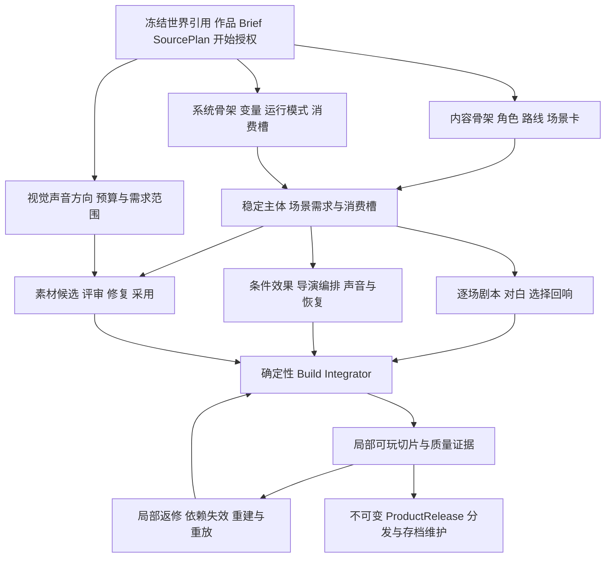

# AVG 三条生产流程的商业对标与研发路线研究

> 版本：1.0.0 · 日期：2026-10-13 · 权威层级：L4 研究与代码核对证据。
> 产品：AVG/Galgame。关联：总纲 §6、E-AVG-01。
> 代码基线：origin/main `83ad0231c7ab85f1b9725940861899b07a7d69b1`。
> 状态：研究结论与研发建议；未实施新功能，未生产或验收商业作品。工作包须落实到 AVG 专项 L2 契约和当前路线图后施工。

建议把 AVG 的后续目标确定为：**作者能够用 StoryForge 制作有鲜明人物、有效分支和完整视听节奏的原创视觉小说，从剧本修订一直交付到可独立游玩的冻结版本。** 最先验证人物关系驱动的悬疑或情感故事，逐步扩展到角色路线、线性视觉小说和少量叙事交互。题材是验证选择，不能成为 AVG 数据模型的限制。

当前最需要增强的是三条线之间的专业交接：内容线提供可演出的场景和选择；系统线把它们变成确定性规则、演出编排和玩家操作；媒资线按稳定主体与消费槽生产美术和声音。以关键场景的表现质量、作者修改效率和真实玩家体验决定扩展顺序。

## 1 任务边界与三个流程

总纲所说的三个流程是 **S3.1 的游戏内容制作、产品系统配置、媒资生产**，共同进入确定性的 Build Integrator。它们与 `S1 世界封存 → S2 产品定向 → S3 产品执行` 是两个层次。[总纲 §6](../PROJECT-MASTER-CHARTER.md#6-世界引擎之上的衍生产品)

| 项目 | 本轮及后续边界 |
|---|---|
| 生命周期 | 本轮研究 AVG 产品能力研发；后续用具体作品检验能力。软件开发工时、作品制作工时、作品市场结果分别记录 |
| 阶段 | S2 确认体验、规模、预算和开始授权；三条制作线属于 S3.1；试玩、发布、存档维护继续属于 S3 |
| owner | AVG Work 拥有剧本、路线、系统配置、演出、媒资、Build、ProductRelease、Session 和存档 |
| 世界引用 | 只读准确 WorldRelease，经 AVG requirement adapter、冻结 SourcePlan 和实际 Context Manifest 读取 |
| 交接物 | WorldReference、ConfirmedProductBrief、ProductSourcePlan → 本产品受治理 Artifact → ProductBuild → ProductRelease 与 SourceManifest |
| 媒资 owner | AVG 作品及其 production/build/release；世界只提供语义依据 |
| 本轮范围 | 历史追溯、商业案例、代码闭包、研发方向、工作包与验收建议。产品代码和浏览器作者数据未改动 |

正式 AVG 继续遵守世界衍生产品链路。S2 可以先保存没有世界的构想；正式制作仍需冻结来源。作者新创作的剧情和演出归 AVG，不自动改变世界或原小说。[上层产品契约](../products/UPPER-PRODUCTS.md)

## 2 历史需求及仍应保留的决定

Git 归档中的 `AVG-1-VISUAL-NARRATIVE-DESIGN.md` 已经明确背景、多人立绘、CG、四类音频、有限 2D Cue、历史、自动、已读快进、存档、纯文字降级与作者时间线。它还明确：剧情真相和演出分离，AI 媒资先成为候选，玩家运行不依赖模型。历史材料使用清理前提交 `5679dada86d102c9b55b8d897bf0a8ff5795d1b3` 追溯，不能恢复其中旧表、旧产品分类和世界拥有媒资的发布路径。

后续 `GAME-PRODUCTION-PIPELINE-BLUEPRINT-V3.md` 强调自动拆需求、实际绑定素材、可玩 Preview、有限重试、不可变发布和商业媒资证据。2026-09-15 的 `50bd6baa` 接上 AVG 作者入口、修订和玩家；`5b9e78e1` 收束一级导航。当前事实以代码和能力基线为准。

10 月 8—9 日的历史对话还提出两点：收入希望来自实际作品；用剧情和立绘取胜需要认真投入。本研究按这两个方向设计投入上限、外部试玩和扩展闸门。成人向曾作为市场假设出现，尚无销量、净收入或团队适配证据支持将其定为首作路线。

| 历史目标 | 本轮处理 |
|---|---|
| 商业 AVG 的整体体验 | 保留为质量目标，并拆成场景、路线、演出、声音、玩家操作和交付证据 |
| 作者导入和 AI 生产媒资 | 继续并存；按参考图实传、实际字节、权利、费用和采用结果验收 |
| 剧情逻辑与演出分离 | 保留；静音、减少动态、图片降级不能改变选择、旗标和结局 |
| 任意 Beat 预览和局部修改 | 增强为作品级生产反馈循环，修改后只重建真正受影响的依赖闭包 |
| 一次生成完整游戏 | 改进为来源评估、角色与路线设计、分场、对白、演出、媒资、切片和修订的专业流程 |
| 工程验收与商业完成 | 分别记录；历史 IMPLEMENTED 标签只能说明当时的工程交付 |

## 3 当前代码能做什么及主要差距

当前 `E-AVG-01` 为 partial；内置《雾港：失潮钟声》是预写作品，其存在不提升通用生成能力的商业成熟度。[能力基线](../roadmap/CAPABILITY-BASELINE.md)

| 闭包位置 | 当前证据 | 后续判断 |
|---|---|---|
| 作者入口 | [AvgPage](../../src/pages/AvgPage.tsx)、[navigation](../../src/components/avg/navigation.ts)：作品库、世界、制作台、版本、游玩；S2 草稿可无世界保存 | 保留现有入口，在制作台内增强场景工作流 |
| 产品定向 | [authoring-contract](../../src/lib/avg/authoring-contract.ts)：身份、开场、体验、时长、结局、路线/变量描述、画幅、视听等级 | 目前适合轻量意图表达；需要专业剧本、演出和资产范围的结构化约束 |
| 会谈读取 | [consultation](../../src/lib/avg/consultation.ts) 与 `avg.consult.v1`：读取 `avg.authoring`；提示明确尚未读取世界原文 | 会谈已有候选确认；后续世界适配评估须经正式网关，不能仅加强提示词后声称已懂世界 |
| 世界来源 | [AVG_WORLD_REQUIREMENT_ADAPTER_V1](../../src/lib/product/world-requirement-adapters.ts)、production Context Gateway | 复用现有来源、权限、版本与渐进读取体系 |
| 候选及正式采纳 | [FIELD_REGISTRY](../../src/lib/registry/field-registry.ts) 已登记 Production Brief、Plan、Artifact 等写口；[adoption](../../src/lib/product-production/adoption.ts) 管发布采纳 | 新 AVG 产物应接该边界，禁止另建 AI/DB 写入口 |
| 内容生产 | [createProductProductionPlanV3](../../src/lib/product-production/plan.ts)：AVG 仍走通用设计、叙事、产品模块和媒资需求路径 | 缺少与 AVG 对应的专业分工和中间产物；不能把文字冒险专属生产图原样复制过来 |
| 默认组装 | [production-executor](../../src/lib/product-production/production-executor.ts) 的 RuntimePackage 组装按素材类型生成基础 Cue | 引用绑定已经存在，逐场景导演设计仍需增强 |
| 演出运行 | [AVG 类型](../../src/lib/types/avg.ts)、[applyAvgCue](../../src/lib/avg/runtime.ts)、[cue-timeline](../../src/lib/avg/cue-timeline.ts)：白名单 Cue、舞台状态、快照；等待按 Cue 顺序累加 | 增强语音/文字/动画之间的调度和确定性恢复语义 |
| 作者返修 | [prepareAvgRevisionV1 / runAvgRevisionV1](../../src/lib/avg/revision-production.ts)：作者修订进入新版本，保护身份、来源、旧 Build 和素材归属 | 已有可靠入口；当前修订仍以整包方案为主，应定位场景及受影响产物 |
| 媒资生命周期 | [editor-service](../../src/lib/avg/editor-service.ts)、[PROJECT_TABLES](../../src/lib/registry/project-tables.ts)：AVG 草稿素材、共享 Blob、备份与重映射 | 保留完整生命周期；新增表之前先证明现有 Artifact 无法承载 |
| 媒资检查 | [media-quality-policy](../../src/lib/product-production/media-quality-policy.ts)、runtime verifier：尺寸、alpha、音频响度/峰值/循环及 hash 证据 | 技术可用已有门；人物一致、构图、情绪和声音表现还需实际内容评审 |
| 玩家路径 | [AvgGamePlayer](../../src/components/text-game/AvgGamePlayer.tsx)：目录、详情、舞台、历史、快进、自动、检查点、独立存档 | 日常阅读基础已有；作品封面、路线回放、鉴赏、分通道声音和演出体验可继续完善 |
| 分发 | [ProductDistributionBundleV2](../../src/lib/product-platform/distribution-bundle.ts) 已有冻结 release 与媒资的自包含分发基础 | AVG 作者备份、可导入分发包、独立离线播放器、Steam 发行是不同交付；最后两项仍需专项验证 |
| 测试 | [AVG E2E](../../tests/e2e/avg-integration.spec.ts)、R-AVG2～5 与生产/媒资回归 | 证明相应路径有测试；其中会谈拦截和预写 fixture 不能证明真实模型文学/视听质量 |

最应优先处理的五个具体差距：

1. **通用叙事产物粒度偏粗。** 人物弧、场景冲突、路线差异、信息揭示、对白修订缺少 AVG 专属生产交接。扩大字数容易扩大返工。
2. **默认 Cue 编译偏向素材挂接。** 当前角色槽位按数组序号轮转左/右/中，音频使用通用音量 0.7，基础 Cue 多在 Beat 前执行。这能接通素材，但无法代替镜头、走位和情绪节奏设计。
3. **声音还缺导演级调度。** StageAudio 是 HTML audio 播放；自动推进在文字完成及 Cue 等待完成后再等 650ms，没有绑定语音结束。当前 reducer 每个音频类别保留一个 activeAudio 项，复杂叠加 SFX、交叉淡化和配音自动阅读需要专门契约。
4. **角色表情和作品包装可继续提升。** show-actor 用完整 asset 替换角色状态；分层表情与身体组合尚不能由资源类别名称推定已实现。目录详情仍使用通用书本图形和场景/对白/Cue 数量，需要作品封面、简介、真实时长、内容提示及重玩价值。
5. **S2、生产能力和商业证据需要对齐。** 播放类型已有 voice，S2 音频等级目前只有 none/music-sfx；商业候选的 intent/adapter 标志不等于逐作品体验、费用、权利和外部分发已验收。

以上是本次源码核对结果，未扩大为缺陷修复任务。实现时应为这些场景取得定向反例证据。

## 4 商业作品对标

选择 15 个直接或接近 AVG 的商业样本，以及 2 个相邻叙事产品，覆盖传统视觉小说、悬疑、角色路线、独立作品、中文原创和有限交互。表中“可吸收方向”是结合源码的研发推论；官方宣传和商店功能描述不等于本项目质量认证。

### 4.1 角色与情感叙事

| 商业样本及来源 | 可核实的产品特点 | 对 StoryForge 的启发与投入边界 |
|---|---|---|
| [CLANNAD](https://store.steampowered.com/app/324160/CLANNAD/) | 角色关系与家庭经历；词条百科、进度查看、语音和美术 | 角色日常需要推动关系和后续情绪；先完善角色弧、回收与词条，长篇体量后置 |
| [ATRI My Dear Moments](https://store.steampowered.com/app/1230140/ATRI_My_Dear_Moments/) | 海面上升背景下的少年与机器人故事；官方列出剧本、美术指导、音乐、动画和背景岗位 | 清晰核心关系与统一视觉方向值得借鉴；人物、美术、声音必须围绕同一体验目标 |
| [海市蜃楼之馆](https://store.steampowered.com/app/303310/The_House_in_Fata_Morgana/) | 跨时代的哥特悬疑和悲剧；本商店语言表未列完整配音 | 文字、独特画风和音乐也能构成完整定位；配音是否必需由作品决定 |
| [饿殍 明末千里行](https://store.steampowered.com/app/2593370/?l=schinese) | 中文原创历史旅行题材，明确主角目标、同行人物、选择和真相；提供 Demo | 中文主题、人物关系和道德困境有具体样本；历史题材考证及声音/美术投入仍需认真规划 |
| [恋爱绮谭 不存在的真相](https://store.steampowered.com/app/1777430/) | 都市悬疑与恋爱；发行方说明 40 万字、对白全配音、听完约 14 小时 | 国内作品也要求完整视听交付；该规模只作远期参照，不能套成第一阶段指标 |

### 4.2 分支与信息揭示

| 商业样本及来源 | 可核实的产品特点 | 对 StoryForge 的启发与投入边界 |
|---|---|---|
| [STEINS GATE ELITE](https://www.spike-chunsoft.com/games/steinsgate-elite/) | 高概念时间故事、分支结局；使用既有动画及新结局动画 | 先研究因果、选择与揭示顺序；大量既有动画是其资源前提，不能直接视为低成本模板 |
| [Slay the Princess The Pristine Cut](https://serenityforge.com/games/slay-the-princess) | 选择改变叙事，手绘风格、完整配音；新版加入路线、结局和回顾图库 | 少地点也能有高密度分支，但绘制、对白、配音及回归工作量仍很大；适合借鉴选择回响 |
| [Scarlet Hollow](https://store.steampowered.com/app/1609230/Scarlet_Hollow/) | 人物特质影响对白，动态关系与大量角色/环境变体；分期交付 | 关系不必只有好感一条轴；先用少量有剧情用途的维度，控制状态组合和持续维护成本 |
| [PARANORMASIGHT](https://www.square-enix-games.com/en_US/home/choose-fates-paranormasight-seven-mysteries-honjo) | 多人物命运、调查/对话、360 度环境背景与选择 | 将“玩家知道什么、什么时候知道”纳入路线设计；360 度交互须由作品需求和性能验证决定 |
| [逆转裁判三部曲](https://store.steampowered.com/app/787480/Phoenix_Wright_Ace_Attorney_Trilogy/) | 法庭案件叙事；章节选择、自动阅读、故事模式及音乐/美术鉴赏 | 关键推理节点要有规则和可理解反馈；故事辅助模式与普通自动阅读应分别配置 |
| [AI 梦境档案 涅槃肇始](https://www.spike-chunsoft.com/games/ai-the-somnium-files-nirvana-initiative/) | 双调查者的悬疑冒险；官方维护记录包含音效、镜头、口型、动画和性能调整 | 借鉴信息与演出协同、发布后修复；3D 演出与探索将显著扩大系统和资产范围 |

### 4.3 电影式角色路线与少量交互

| 商业样本及来源 | 可核实的产品特点 | 对 StoryForge 的启发与投入边界 |
|---|---|---|
| [魔法使之夜](https://store.steampowered.com/app/2052410/WITCH_ON_THE_HOLY_NIGHT/) | 高清画面、全配音，动画图形元素用于日常和战斗；官方强调视觉编排 | 借鉴镜头、光线、停顿和声音共同形成场景；先做少数高表现力场景，逐步扩展资源种类 |
| [BUSTAFELLOWS](https://store.steampowered.com/app/1494470/BUSTAFELLOWS/) | 悬疑与角色恋爱路线、多结局、动画表现、完整日语声优；有 Demo | 共通剧情与角色专属剧情要有各自目标；演出与 UI 对角色辨识度也有贡献 |
| [BUSTAFELLOWS season2](https://store.steampowered.com/app/3026310/BUSTAFELLOWS_season2/) | 五条角色故事、回放流程图、额外章节、人物服装场景变化与配音 | 作者路线图与玩家已解锁路线回顾应分开；图库及额外章节来自可校验解锁状态 |
| [Coffee Talk](https://store.steampowered.com/app/914800/Coffee_Talk/) | 调制饮品影响故事分支，像素视觉、爵士与 lo-fi 氛围 | 少量交互可以表达人物关系；每个交互先证明叙事用途和完整反馈，避免增加独立经营负担 |
| [VA 11 HALL A](https://store.steampowered.com/app/447530/VA11_HallA_Cyberpunk_Bartender_Action/) | 饮品制作承载选择与分支，PC-98 风格视觉和酒吧叙事 | 将动作与剧情后果绑定值得借鉴；具体玩法作为 AVG 可选模块，先完成确定性契约 |

### 4.4 相邻产品的参考范围

[十三机兵防卫圈](https://13sar.jp/system/) 把十三人视角的叙事、战斗和档案回顾结合。可研究多视角揭示和已见事件回放；战斗、十三条主角线、专属动画应视为另一量级的制作负担。

[As Dusk Falls 的开发者 GDC 介绍](https://www.gdcvault.com/play/1028903/A-Narrative-Multiverse-The-Branching) 强调在宏观上设计分支树，在写作时把每条路线当作有角色、情绪和主题的故事。它支持“每条实际路线要独立成立”的方法选择。本轮只读取公开介绍，未观看完整讲座；其互动剧的系统规格不直接进入 AVG。

这些样本共有的价值是明确体验与协调的制作选择。它们的引擎、资产规模、团队和商业条件不同，不能把所有机制相加后当作一个 AVG 必备清单。

## 5 从商业样本转成制作原则

### 5.1 每场戏都要有可感知的变化

场景卡至少回答：谁想得到什么、谁或什么阻止他、玩家此时知道什么、这场戏如何改变关系/信息/目标、哪一拍最值得演出。角色圣经包含欲望、矛盾、隐瞒、关系变化和说话习惯；对白需要潜台词、动作和差异化声音。

Scarlet Hollow 的开发者复盘说明，早期介绍虽然完成信息和教学目标，仍缺情绪钩子；为见全角色而安排的跑腿也被删改。[开发者改写复盘](https://blacktabbygames.medium.com/5-rewrites-that-made-scarlet-hollow-a-better-game-5e12358b7f55)

研发推论：生成流程应能删掉低价值场景、重写开场和调整角色登场时机。质量检查同时看单场冲突与整条路线，不能只验字数和图连通。

### 5.2 选择要产生可辨认的回响

为重要选择记录即时回应、后续场景变化、结局贡献及玩家可用的判断依据。允许部分选项只表达态度，但必须在设计中声明；关键选择需要真正影响后续信息、关系、行动或结局。汇流之后保留必要差异，避免每个选项都扩大为一整条新路线。

Scarlet Hollow 的开发者解释了为何从简单赞同/反对积分转向多个关系维度：同一句话的含义会随既有关系改变，单轴容易诱导玩家寻找固定正确答案。[关系系统设计](https://blacktabbygames.medium.com/creating-a-dynamic-relationship-system-in-scarlet-hollow-eb175aa899a8)

研发推论：先支持信任、坦诚等少量有真实剧情用途的变量，所有条件和效果由代码验证。人物的关系设计可以丰富，执行规则仍应保持有限、可测试。

### 5.3 美术投入围绕人物与剧情重点分配

先确认角色基准图、剪影、色板、材质、背景空间与 UI 语言，再生产姿态和表情。表情变化、服装和光线必须对应同一个稳定角色。CG 用于关系转折、真相揭示和高潮；背景应有可重用的构图与昼夜/天气需求，避免逐句生成。

魔法使之夜的官方资料把视觉编排、动画脚本、美术监督、背景和音乐分别列为制作职责。[官方制作资料](https://mahoyo-en.com/product/)

研发推论：角色一致性、构图及场景用途优先于图片数量和像素尺寸。模型能生成图片不代表能稳定产出一整部作品；参考图实传、透明边缘、连续场景身份和修复成本都要实测。

### 5.4 音乐与声音承担剧情节奏

为作品制定音乐主题、人物/关系动机、环境声层、关键 SFX 和需要安静的时刻。内容线说明情绪目标，系统线拥有通道与时序，媒资线提供符合长度、循环和音色要求的音频。配音可全量、重点场景或无配音；配置与实际覆盖一致。

Coffee Talk 的音乐制作访谈介绍了统一风格下的作曲、编配和混音；其玩法复盘也显示，饮品系统需要反复调整才能正确推动剧情。[音乐制作](https://medium.com/toge-productions/coffee-talk-devlog-3-lo-fi-music-album-in-a-game-4f2b6de7bb73)、[玩法迭代](https://medium.com/toge-productions/coffee-talk-devlog-4-brewing-the-gameplay-mechanics-and-latte-art-feature-3c6c1fdf7116)

海市蜃楼之馆还把音乐作为独立可销售交付，原声页面列出 68 首曲目。[官方原声商品](https://store.steampowered.com/app/458790/The_House_in_Fata_Morgana_Original_Soundtrack/)

研发推论：优先补声音编排、分通道控制、语音等待和循环恢复。是否委托音乐、生成候选、使用授权曲库，由作品质量和费用比较决定；生成供应商不是唯一制作路径。

### 5.5 修改和预览必须成为主操作

| 作者工具来源 | 可核实的能力 | 适用于本项目的选择 |
|---|---|---|
| [Ren'Py 音频](https://www.renpy.org/doc/html/audio.html)、[语音](https://www.renpy.org/doc/html/voice.html)、[自动阅读配置](https://www.renpy.org/doc/html/config.html#auto-forward-mode) | 通道、渐入渐出、队列、逐句语音标识与角色静音；自动阅读可等待声音 | 借鉴对白稳定 ID、声音调度和用户偏好；先增强当前播放器，外部导出再单独验证 |
| [Naninovel Story Editor](https://naninovel.com/guide/editor)、[配置](https://naninovel.com/guide/configuration) | 场景脚本、故事图、浏览器草稿预览、修改脚本后热重载 | 采用场景选择、剧本编辑、舞台预览、属性检查的一体工作流；保留 Artifact 和发布版本边界 |
| [TyranoBuilder](https://tyranobuilder.com/) | 拖拽式制作、浏览器导出、镜头控制等 | 浏览器 AVG 有商业工具参照；可以先做声明式场景导演，不必从专业视频编辑器起步 |
| [Live2D 发布许可](https://www.live2d.com/en/sdk/license/) | SDK 发布有许可分类；可扩展应用有单独要求 | 放在可选增强。StoryForge 工具和固定游戏须分别核对适用分类，不能套用普通小型游戏豁免 |

当前 React/TypeScript Runtime、三注册表、来源治理和 Blob 基础值得继续使用。第一阶段保留它们并增强 AVG 专属生产、导演和播放器。Ren'Py/Naninovel 可作为对照；若未来增加导出 adapter，必须逐项验证 Cue、变量、来源、资产和存档语义映射，不能产生第二套内容真相。

Ren'Py 官方也记录了 Web 平台的图片加载、音视频和线程限制，因此更换引擎并不会自然解决浏览器交付问题。[Web 平台说明](https://www.renpy.org/doc/html/web.html)

## 6 产品方向和目标顺序

| 方向 | 建议顺序 | 进入条件 |
|---|---|---|
| 人物关系驱动的悬疑/情感 AVG，有限关键选择，重点场景演出 | 首个验证方向 | 小角色集、少地点、明确故事钩子和关系冲突；能完成短切片与两条有区别的结果 |
| 共通线加角色路线的 Galgame/乙女作品 | 第二验证方向 | 路线、对白差异、表情与关系变量已证明可维护；每条路线有独立主题和价值 |
| 线性视觉小说、单线高演出作品 | 同一 AVG 能力的后续模式 | 质量门应按作品契约表达，避免为了通用 graph 门被迫制造无意义选项 |
| 调查、证据或饮品等一个核心叙事交互 | 可选增强 | 交互完整、可理解且确实服务剧情；专属规则和 UI 验证闭环 |
| Live2D、分层角色动画、视频、360 背景 | 按表现瓶颈进入 | 实测当前表情/镜头方案不足；模型或资产制作、许可、性能及恢复成本可承担 |
| 全动画、3D 探索、复杂战斗、多玩法组合 | 远期 | 完整作品和外部反馈支持扩大团队/预算；需单独立项论证 |

第一批目标按四层递进：

1. **产品能力层：** 作者能可靠地修订场景、路线、变量、演出和素材，理解变化影响，并交付新版本。
2. **制作效果层：** 同一切片里的角色、文本、画面、声音、选择和恢复形成完整体验；真实模型和媒资供应商有证据。
3. **作品层：** 一部范围可控的完整原创 AVG，通过作者及独立玩家验收；第二个不同题材样本证明通用性。
4. **商业层：** Demo、商店素材、独立包、定价试验、市场反馈和实际到账分别取得证据。

## 7 三条线的具体改进流程

### 7.1 游戏内容制作线

流程：冻结来源与缺口评估 → 创意/主题 → 角色与关系弧 → 路线与信息揭示图 → 场景卡 → 分场剧本 → 对白与潜台词修订 → 选择回响 → 文学/可玩双审查 → 作者确认。

建议的逻辑产物包括故事圣经、角色圣经、路线计划、场景卡、对白包和内容评审。均归 AVG Work，通过现有 Artifact 承载；具体 schema 和 Skill ID 在专项契约中确定。

场景卡至少给系统及媒资线这些信息：稳定 scene/beat/character/location ID、在场者、已知信息、剧情变化、关键选择、表情/姿态需求、画面重点和声音意图。内容线描述人物紧张，不能直接指定未验证音量公式或任意脚本。

长篇与小说转剧本已有的叙事知识可以用于只读来源或已证明中立的公共能力；AVG 自己拥有改写后的可玩剧本、路线和结局，不接管源 Work。

### 7.2 产品系统配置线

流程：作品运行模式 → 有限变量与状态 → 选择条件/效果和解锁 → 导演需求及消费槽 → 声音/舞台调度 → 编译 → 路线重放 → 存档与发布兼容验证。

优先增强以下职责：

- 变量类型、初始值、边界、读写位置和稳定身份；信息、关系、剧情进度按作品使用。
- 选项可见性、可用性、效果、汇流、结局与已解锁内容；避免用 Prompt 代替条件校验。
- 逐 Beat 的导演编排：进退场、表情、焦点、镜头、转场、文字速度、停顿和声音。
- 文本完成、动画/等待完成、语音结束的协调；手动、自动、已读快进分别有明确策略。
- BGM/环境音/语音/可叠加 SFX 的通道、淡化、优先级、打断与声音焦点；用户音量独立于作品混音。
- 已见剧情只读回放与从检查点创建新路线分开，禁止流程图跳转绕过旗标和权限。
- 版本绑定、存档、读档后舞台/声音恢复和发布后升级；旧 release 与旧档保留。

演出编排是系统线的配置职责。内容线提供目的，媒资线提供资产，组装器生成正式跨线引用。它不新增第四条创意线，也不允许 Cue 改写叙事变量。

### 7.3 媒资生产线

流程：视觉/声音方向与预算 → 稳定角色及地点参考 → 需求清单和消费槽 → 生成/委托/授权导入候选 → 技术检查 → 连续场景内容评审 → 修复与选择 → 作者采用 → 新资产版本与绑定 → 实际 Build 播放验证。

资产先按家族组织：角色基准、姿态/表情、地点变体、关键 CG、标题与 UI、音乐主题/变奏、环境声、SFX、逐句语音。需求清单记录必要/可选、对应场景、复用范围、制作方式、成本上限、权利和允许降级。

优先级是角色辨识与连续一致 → 有剧情用途的姿态/表情 → 背景构图和空间一致 → 关键 CG → 声音与混音 → 复杂动画。声音基础与场景演出可早期并行规划，不能等全部图片完成才补音乐。

真实资产评审同时检查角色身份、服装、动作、画面层级、声音情绪与使用场景。现有 hash、尺寸、alpha、LUFS 和 loop 门继续作为技术约束，不能独自证明美术或音乐好。

### 7.4 依赖与组装

主 Agent 负责计划、阻塞、预算和返修定位；专业 Skill 负责有限候选；确定性服务负责 ID、条件、权限、编译、hash、stale 和发布。具体 Agent 数量随任务变化，不先规定三个常驻 Agent。

## 8 作者实际操作应怎样完善

继续使用作品库 → 制作台 → 发布与版本 → 游玩的一级结构。制作台重点提供以下操作：

1. 定向时看清故事目标、主角与关系、规模、视听方向、预算、来源缺口和完成条件，再明确开始。
2. 制作时看三条线的产物与依赖、已消费素材、待确认决定、费用与阻塞；进度从真实任务回执投影。
3. 编辑时以场景为中心：路线图选场 → 对白编辑 → 舞台预览 → 演出及媒资检查。保留必要的变量页和资产库，但让作者能在一场戏内完成主要工作。
4. 评审问题能定位到具体 scene/beat/choice/cue/asset，提供作者直接编辑和有限候选修复；修改前说明后续影响。
5. 试玩与发布时看到准确版本、有效质量证据、已知限制、必须资产、兼容情况和目标分发包。

玩家看到作品封面、简介、内容提示、新游戏/继续、沉浸舞台和按需菜单。已解锁路线、CG/音乐鉴赏、语音回听可以逐步提供；内部 key、事件序号和治理诊断保留在作者检查面。

## 9 一场戏的交接示例

以下是新创的设计示例，用来说明职责；不是现有世界事实或已经生产的作品。

场景：暴雨夜，档案员发现同行者隐瞒了一封信。玩家决定当面追问还是暂时替他保密。

| 剧情拍 | 内容线 | 系统与演出配置 | 媒资消费 |
|---|---|---|---|
| 进入 | 地点、两人关系和当前任务简短建立 | 场景初态、文字节奏、背景进入和环境声启动 | 同一室内背景、两角色既定姿态、雨声 |
| 发现 | 信件上的细节与此前说法冲突 | 信息旗标由正式剧情事件取得；镜头突出细节 | 信件局部素材或关键 CG、轻微纸张声 |
| 对峙 | 同行者回避，档案员提出具体问题 | 表情切换、焦点移动、音乐淡出、短停顿 | 同一人物紧张表情、音乐停止后的环境声 |
| 选择 | 两种行动各有合理代价 | 选项条件/效果；自动播放停下；选择前检查点 | 选择 UI，重要文字不依赖音效传达 |
| 回响 | 当面追问或保密改变即时回应和后续关系 | 确定性状态变化；不同对白/表情；后续场景消费变量 | 已有角色资产复用，两种声音/表情编排 |

该场景同时验收三种结果：玩家理解了冲突；选择真正产生差异；读档、静音或减少动态后逻辑一致。它比资产数量或 Cue 种类更接近整体体验目标。

## 10 建议研发工作包

以下为 E-AVG-01 下的建议子单元，尚未写入当前 backlog。每个单元产出可评审的产品能力，具体作品生产另记账。

| 顺序及建议 ID | 交付内容 | 依赖与完成判据 |
|---|---|---|
| AVG-00 专项契约 | AVG 运行模式、三线范围、逻辑产物、作者旅程、质量成熟度与首切片规格 | 复用本次基线；明确 S2 与 S3、owner、注册表和旧数据兼容；建立唯一 AVG 施工入口 |
| AVG-01 内容生产 | 角色/关系弧、路线/揭示、场景卡、对白与选择回响的 Skill 和 Artifact | AVG-00；真实文本模型得到可编辑切片，刷新/失败恢复和来源边界正确 |
| AVG-02 规则与导演 | 有限变量、选择和解锁、逐 Beat 编排、白名单编译与反例 | AVG-01 的稳定主体；场景能解释剧情及演出，非法引用/副作用阻断，纯文字逻辑等价 |
| AVG-03 声音与播放 | 自动/快进/语音协调，分通道、淡化、叠加 SFX、预加载和恢复 | AVG-02；有声场景、快速切页、读档、后台返回及声音失败有明确结果 |
| AVG-04 真实媒资 | 角色基准与变体、背景/CG、声音候选、参考图能力与人工评审 | 骨架稳定后与 AVG-02/03 部分并行；真实 provider 或授权导入取得连续场景、成本和权利证据 |
| AVG-05 场景工作台 | 场景选择、剧本/舞台联动、Cue 编辑、问题定位和依赖闭包返修 | AVG-01～04；作者能更改对白/表情/分支，正确保留或使下游失效，旧发布不变 |
| AVG-06 可玩切片验收 | 一个 15～30 分钟作品切片、完整三线、两个差异结果和外部试玩 | AVG-05；同时取得结构、真实内容、视听、恢复与人类反馈；失败先返修同一切片 |
| AVG-07 作品交付 | 独立播放器/离线包、标题/鉴赏/路线回顾、版本存档、Demo 与商店材料 | 切片通过且分发目标冻结；不携带作者配置/密钥/未公开源世界；隔离安装、离线与升级验证 |
| AVG-08 通用性及规模 | 第二题材与第二运行模式验证，再扩到完整作品和专业增强 | 前述闭环稳定；能复用生产能力而不硬编码首作，取得维护、成本和外部反馈 |

建议先打通 **AVG-00 → AVG-01/02 → 一场 3～5 分钟的完整场景 → AVG-03/04/05 → AVG-06**。这场短戏包含表情、镜头、BGM、环境声、SFX、少量逐句语音、关键选择及读档，能尽早发现三线交接问题。之后才扩大到 15～30 分钟切片。

《雾港》适合作旧版本/旧素材回归样本；首个新切片检验真实生成与修改；第二个不同题材样本检验通用性。三者不要混用为同一项验收。

Shared schema、三注册表、世界 gateway、公共生产协议或锁文件的变化先形成小范围基础提交并串行验证。AVG 分支只改必要 adapter、Skill、私有产物、作者 UI、演出和运行逻辑；共享 executor 的调整必须复验受影响产品。

## 11 切片规格和验收目标

本节为建议预注册指标，需在具体作品 Brief 中冻结。数值用于控制范围和检验目标，不能当作行业标准或当前成绩。

### 11.1 首切片范围

- 单次正常游玩 15～30 分钟；先实测阅读及演出时长，再调整文本。
- 1 个核心冲突、2～3 名主要人物、3～4 个可复用背景主体。
- 2～3 个关键选择、2 个有实质差异的结果；至少一个早期选择在后续场景回响。
- 每名主要人物先有基准形象与 4～6 个剧情必要表情，姿态按场景需要生产。
- 2～3 张关键 CG、标题封面与基本 UI；3～4 段可复用音乐、必要环境声及 8～12 个 SFX。
- 配音先覆盖一段关键场景，验证逐句绑定、演员/音色一致、读档和自动阅读后再扩大。

数量是示例范围，可以按 Brief 缩减或替换；必需项、品质及引用闭合保持清晰。小切片也需要成品感，允许降级必须如实展示。

### 11.2 四种不同的验收

| 验收 | 必需证据 |
|---|---|
| 机器可执行 | 角色/场景/选项/Cue/资产引用有效；覆盖两结果和关键条件反例；事件重放一致，非法条件/越权和悬空资源拒绝 |
| 作者接受 | 作者完整试玩并确认人物动机、语言、关系变化、场景表现、来源边界及采用素材；问题定位和修订记录可复查 |
| 独立玩家验证 | 建议至少 8 名目标读者；记录原始 n/N、游玩时长、理解问题、停顿/退出点和评分；至少 6 人无指导完成，剧情/人物/演出各项中位数目标 4/5 |
| 分发准备 | 精确 release 的权利、费用、内容说明、纯玩家包、设备表现、离线和存档升级验证；目标平台审核和真实市场结果另记 |

独立试玩还要求至少 6/8 能用自己的话解释核心冲突和关键选择后果，至少 4/8 表示愿意尝试另一条结果。小样本只决定是否继续试验，应保留失败反馈；这些数字不是销售预测。

声音关闭、减少动态、素材缺失、浏览器音频被阻止、读档和切后台都不能损坏剧情。发布必需素材缺失时，按冻结契约阻断发布或使用明确允许的降级；不能把无声/占位路径冒充该作品已达视听目标。

性能建议先冻结具体设备与环境：桌面和移动端各一档；30 分钟连续游玩无崩溃、卡死或持续内存增长；已缓存场景切换目标 p95≤300ms。若选择 Web Demo，可试设 10Mbps 冷启动下首个可读画面≤8 秒、首屏必要资产≤6MB、完整包≤100MB；初装下载与安装后的离线启动分别测量，超过预算先定位和调整。

代码施工按现行 AGENTS 执行定向回归、架构/表/AI Manual/TS/build、CI 和必要隔离 E2E。真实文学、媒体质量、人类试玩与市场门必须单独取得，CI 不能替代。

## 12 投入和商业验证

### 12.1 商店快照能说明什么

以下是 2026-10-13 访问页面显示的美元标价及指定语言评测字段，受页面缓存、地区、版本与促销影响；用途是观察商业定位，不用于估算销量或本项目建议售价。

| 商品来源 | 页面标价 | 访问页面显示的评测范围 |
|---|---|---|
| [饿殍](https://store.steampowered.com/app/2593370/?l=schinese) | $9.99 | 简体中文 47,181 条，94% 好评 |
| [Coffee Talk](https://store.steampowered.com/app/914800/Coffee_Talk/) | $12.99 | 本表不使用评测数字作跨语言比较 |
| [海市蜃楼之馆](https://store.steampowered.com/app/303310/The_House_in_Fata_Morgana/) | $24.99 | 英文 2,154 条，95% 好评 |
| [BUSTAFELLOWS](https://store.steampowered.com/app/1494470/BUSTAFELLOWS/) | $39.99 | 页面 All Reviews 970 条，86% 好评 |
| [魔法使之夜](https://store.steampowered.com/app/2052410/WITCH_ON_THE_HOLY_NIGHT/) | $39.99 | 英文 1,451 条，97% 好评 |
| [CLANNAD HD Edition](https://store.steampowered.com/app/324160/CLANNAD/) | $44.99 | 该购买选项不与本页其它捆绑包混算 |

这些是选定样本的标价和用户评价，不能证明题材平均成功率、实际销量、净利润或 AI 制作接受度。成熟 IP、团队、宣传、发行和本地化条件存在明显差异。成人向更易销售的历史想法仍是未验证假设。

### 12.2 首切片的投入控制

先用制作台能力降低整理、排错和返工；最终剧本、美术及声音仍需作者判断。不要把模型调用价当作作品全部成本。

以下只是首切片的规划估计，假设有可用产品底座、少人物/少地点、两次主要修订、重点配音；**不含 AVG 软件能力研发工时**，首场景实测后须修正。

| 作品生产项 | 规划工时 |
|---|---|
| 剧本、角色/路线设计及人工编辑 | 20～35 小时 |
| 美术候选、角色一致、修复及采用 | 20～35 小时 |
| 场景演出编排与试玩调整 | 20～30 小时 |
| 音乐、环境声、SFX 与重点配音 | 10～18 小时 |
| 独立试玩、问题修订和版本回归 | 12～20 小时 |
| Demo 包与展示材料 | 8～12 小时 |
| 合计 | 90～150 小时 |

现金预算需要在取得具体模型、资产、声音及分发报价后冻结。记账至少包括生产调用/失败、候选淘汰、委托或授权、返修、分发、推广和实际到账。每轮记录人工编辑后可用产物比例、每个可用资产成本、每个实际游玩分钟制作工时及返工来源。

盈亏算式：现金回本份数＝固定现金成本÷每份实际净到账；含工时回本份数＝（固定现金成本＋投入工时×自定时薪）÷每份实际净到账。仅作示例，若现金 5,000 元、120 小时、时薪 80 元、每份净到账 20 元，则分别需 250 份与 730 份；这些输入不是报价、售价或销量预测。

### 12.3 平台及扩展闸门

Steam 当前区分玩家消费的预生成 AI 内容与运行时生成内容，前者也需要申报；叙事、美术、声音和本地化均在说明范围。本研究推荐首批作品使用制作期 AI 和冻结内容，让玩家直接游玩，并把来源与权利证据随交付准备。[Steam 内容调查](https://partner.steamgames.com/doc/gettingstarted/contentsurvey)

Steam Direct 每个新 app 费用为 100 美元或等值；达到 1,000 美元调整后总收入后可在后续付款中回收，另有适用税费。它只是发行成本的一项。[Steam Direct](https://partner.steamgames.com/doc/gettingstarted/appfee)

Steam Demo 有关联正式游戏的独立 App ID、构建和发布配置，不能把作者端备份当作已完成的商店试玩版。[Demo 官方说明](https://partner.steamgames.com/doc/store/application/demos)

继续/收缩标准：

- 首场景成立，切片质量达到目标，玩家能够解释角色和选择，返工及费用在预设范围内：扩到 60～120 分钟的首个完整作品。
- 核心冲突和人物反馈弱：优先重写开场、角色和选择，随后重编受影响演出，暂停扩大资产。
- 文字成立但视听弱：集中修复少数关键场景、人物一致和混音，保留已合格内容。
- 玩家操作、读档或资产绑定有严重问题：先补确定性系统与恢复，扩大制作前再次验收。
- 连续两轮主要修改仍未达到冻结目标，或费用/工时超上限：缩小题材与演出范围，重新定向；不能通过增加字数、角色或新技术掩盖问题。

完整作品通过后，再研究 3～5 小时作品、多角色路线、Live2D 等扩展。问卷购买意愿、愿望单和真实销售分别记录；稳定收入必须由持续实际净到账证明。

## 13 推荐从哪里开始

第一开发单元是 **AVG-00 专项契约，加一场完整场景的验收设计**。它必须明确角色/路线/场景产物、导演编译、声音调度、资产采用、三注册表落点、局部修订和旧存档保护，然后按 AVG-01/02 实现。

该路径保留已有来源、Harness、媒资、发布与 runtime 底座，逐步把“能生产并播放”提升为“作者能有效制作、修改和交付一部作品”。首切片的题材和规模作为验证集合；产品的长期目标仍是制作多种原创 AVG。

## 14 证据范围与复核要求

本次核对了总纲、上层产品契约、能力基线、当前 AVG 入口及数据/生产/播放/测试闭包，读取 Git 历史并核对历史用户原话。外部材料包括官方商业页面、发行方功能描述、开发者复盘、制作工具文档和 Steamworks 规则。

商业样本按具体版本引用，例如 STEINS GATE ELITE、The Pristine Cut 与 BUSTAFELLOWS season2；功能不能移用于同系列所有版本。动态价格、语言、促销与评测只保留本次页面快照意义。Scarlet Hollow 的较早博客与当前商店在章节规划上存在时间差，本研究未以旧规划确定现行章节数量。

研究未购买或通玩全部样本，也未完成实际音频聆听、逐镜视觉评测或本项目真人试玩；关于视听质量的选择来自公开制作说明与研发推论。已核实公开功能不等于复现了其效果，公开评价不等于本项目市场验证。

本轮文档交付检查只覆盖文档权威登记、本地引用、工作树差异和内容一致性。后续实作使用最终代码、具体 Build 和真实来源/媒资证据重新验证，不能把本报告当作实现完成证明。
