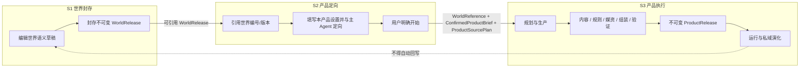

# 世界引擎上层产品跨产品架构契约

> 版本：2.6.0 · 生效：2026-09-28 · 对应总纲：§2.1、§6、§10.1、S1/S2/S3
> 本文只规定跑团、角色互动、AI 小镇、文字冒险、AVG 和文字开放世界共同遵守的架构边界与流转协议，不替代任何一个产品的专项功能设计。

## 1. 契约目的与非范围

上层产品并不是世界引擎里的几个运行按钮，而是引用世界内容后独立生产、发布和运行的产品。本文确保它们在一个共同框架内发展：来源可追溯、阶段不可绕过、所有权不混乱、版本可以演化、未来增加新产品时不复制世界读取和数据生命周期。

本文不决定：

- 跑团怎样车卡、判定、分队或主持；
- 角色聊天怎样调度单人、多角色或小镇居民；
- 文字冒险、AVG、文字开放世界分别怎样设计玩法、分支、结局和界面；
- 一个产品使用几个 Agent、哪些专用表或怎样生成具体媒资；
- 时长、章节、回合、分支或“无限演绎”等产品设置的具体字段。

这些内容必须在对应产品开工时单独研究和设计。总体架构只规定它们放在哪一阶段、由谁拥有、怎样交接和怎样留下版本证据。

### 1.1 产品身份闭集

- 上层产品边界共有：跑团、角色互动、AI 小镇、文字冒险、AVG、文字开放世界。
- 用户可见的文字游戏分类严格只有：文字冒险、AVG、文字开放世界。不得恢复“故事游戏”“独立叙事模拟”或其它历史分类。
- 当前统一生产 Harness 只接受跑团、角色互动、AI 小镇、文字冒险、AVG、文字开放世界六种索引化身份；每种身份都有自己的需求适配器和生产模块。
- AI 小镇拥有自己的 Brief、SourceSelection、生产模块、ProductRelease、runtime 状态与命令；角色回复可复用底层互动事件能力，但必须使用 AI 小镇专属 Skill 和上下文源。
- 叙事模拟是文字开放世界可以调用的内部运行能力，不是产品身份，不拥有独立 Production、ProductRelease、Session 或入口。

### 1.2 产品能力与游戏实例分层

开发某类上层产品与使用该产品生产一个具体游戏/体验是两条生命周期。前者实现作者端、玩家端、数据、编译器、runtime、存档和应用级质量门；后者通过 S1/S2/S3 生产本实例的内容、系统配置、媒资、Build、ProductRelease 和 session。产品基础系统不得由每个游戏实例重新生成，实例配置也不得写回共享产品代码或被误报为产品能力完成。

## 2. 三阶段主链

本文只使用三个规范短名：`S1 世界封存`、`S2 产品定向`、`S3 产品执行`。它们表示所有权、授权和交接边界，不要求三个页面、三张表或一套全产品通用状态机。



三个阶段可以在产品体验中平滑衔接，但不能因共用页面、数据库或 Agent 而合并所有权。

## 3. 阶段职责

### 3.1 S1 世界封存

世界引擎只负责叙事语义内容的编辑、确认、能力描述、封存、比较和版本化读取。它向产品公开可引用的稳定 world code、不可变 WorldRelease ID/hash 和能力画像；用户在 S2 选定准确版本后，产品系统才据此生成并校验 `WorldReference`。

S1 不得创建某个上层产品的设置、production、媒资、build、session、玩家状态或聊天记忆。

### 3.2 S2 产品定向

S2 属于具体上层产品，而不属于世界引擎。用户在该产品入口：

1. 引用并核对世界编号与封存版本；
2. 查看世界能力和与当前产品需求相关的缺口；
3. 填写该产品自己的设置；
4. 与该产品主 Agent 确认目标、限制和方向；
5. 明确下达开始指令。

规模、时长、是否需要结局、参与者或其他体验参数若适用于该产品，应在这里由用户设置；具体字段与单位由产品自己定义。设置保存为产品草稿，不改变来源世界。

用户开始前，系统可以提供只读分析、建议和估算；这些调用也要留下 Context Manifest。不得偷偷启动会产生正式 product production、媒资或 runtime 的工作。开始时冻结 `WorldReference`、`ConfirmedProductBrief`、`ProductSourcePlan` 和用户授权 revision。SourcePlan 锁定世界版本、需求适配器、读取范围、缺失策略与咨询证据，但不假装预先列出生产阶段可能读取的全部资源。

角色聊天实验性 v3 的逐项事实整理归 Chat Work。完整原段先确认为仅作者掌握的事实资料，登记 Agent 生成候选或由作者手工编辑；独立复核同时检查解释、覆盖、初知者及发现条件，作者确认精确候选后才通过 `adopt()` 保存到既有草稿的 `sourceUnitsJson`。旧只读整理/复核 run 不因此取得写权限。新 Brief 携带便携原文证据和确认权限，来源 v6 编译为分别可知的事实；完整原文与限制仅进入协调视角，超出预算必须停止。事实始终保留，包括无人知晓且未允许调查的事实；发现位置不能自动获得经手者或用途。来源、分类或前提过期时拒绝新制作，作者可重新整理或明确移除；已有 Build/Release/Session 不随草稿修改。旧来源 v1—v5 无自动迁移，无新表或世界写入。

### 3.3 S3 产品执行

S3 由具体产品的主 Agent 和内部能力完成。内容、规则、媒资、build、质量证据、ProductRelease、runtime、记忆、存档与私域演化全部归产品实例。Agent 可在 SourcePlan 允许的不可变 WorldRelease 内继续渐进式检索；每个 durable run 保存不可变 Context Manifest。确定性组装器也是正式执行者，不得绕过网关重读世界；它要求的“用户选择 + 语义依赖闭包”必须先在同一 run 中留下可验签原文证据，才能编译 RuntimePackage。

备份导入只重绑可搬运的本地来源引用；冻结 Brief、候选和历史 Context Manifest 不改写。后续世界读取使用经过 scope、release identity、SourcePlan 和 Brief hash 校验的现行本地引用，不使用 Brief 中的历史数据库编号。角色聊天在继续已导入的制作前，先凭原检查点、工件和结算记录本地复验已经完成的步骤；失败或结果未知的步骤不会因此完成。汇总导入前后来源证明时，只有带有导入失效记录且完成本地复验的原 Run，才允许按同一 release UID、资源版本、内容与读取策略核对历史引用。

角色聊天v3的已完成Build也可在导入后零模型调用恢复证明：逐一验证历史原始producer的完成事件前缀、检查点、完整工件与原attempt结算，再复验本轮复用任务和根回执，发布时仍核对完整来源与工件链。无模型调用的作者选开场闸门明确记零费用；旧档仅在证明该闸门未发起模型/工具请求后兼容，原失败记录不改成成功。制作失败及暂停记录中的Run引用由PROJECT_TABLES随备份重映射，缺失映射拒绝；没有便携引用的旧诊断不凭旧数据库编号授权重试。

角色聊天实验性 v3 可在 S2 明确开启“场景人物回应实际问题”，随 Brief 和新 Release 冻结；旧包缺省无此权限。S3 只承接已提交角色问题和当前待处理情境，答复者须有提问前的在场依据，不能代替玩家或可调度主角色。情境候选保存实际原话、听众和逐项发现，独立检查问题、人物、答复边界、听众及有效后果；每项真相确认还需分别满足冻结来源与发现条件。原话只证明说过，拒答、不确定或普通说法不自动成为真相。一次事件原子提交说法与获知的事实，角色读取实际听到的答复，玩家只看到自己听见的场景人物原话。它复用 chatSituationRuntime/chatSituationCandidate、既有运行候选及 productRuntimeEvents 生命周期，无新表、AI 写入口、世界写入或旧 Release 自动扩权；取消、stale、未知结果不部分提交，分支与导入保留来源关系。

角色聊天的记忆管理属于实例私域事件，适用于既有v2及实验性v3存档：玩家可对来源共同可见的已采用记忆明确停用、恢复或撤回，并以真实消息摘录原子更正摘要。修正保留旧条目、替代关系和来源，不改写原作或已发生的情境事实，也不复用过期行动候选；满容量允许等量替换，停用记忆的修正不隐式重新启用。记忆状态及玩家修正来源随既有实例备份、分支重基和删除生命周期管理，无第二套记忆表。玩家修正来源不等于模型忠实性或可见性审查；模型记忆提议的正文安全仍需独立证据，不能只凭引用消息公开就向玩家展示。角色聊天的新模型记忆提议须通过独立正文审查，专用上下文只含精确候选及角色与玩家共同可见的引用消息，证据不可裁剪；通过后仍由玩家决定采用。正文与来源绑定的便携凭据随实例生命周期保存，审查理由及凭据原文不进入角色记忆输入。旧未检查正文暂不展示、不自动复验，既有采用状态及历史保留。管理页仅展示共同可见的真实消息依据；旧摘要不预填编辑框，玩家可据原消息重写并明确采用自己的文本，容量仍受冻结人物设置约束。修正、停用、恢复和撤回均校验当前作品、实例与状态版本；多页面冲突保留表单内容，重新核对来源后才可提交。历史可逐条追踪修正去向；分支继承后可独立管理，撤回历史不再用于后续对话。审查失败保留场景和原响应，未知请求不重发；玩家可明确跳过整理结束场景。

角色聊天实验性v3的新调用采用版本化记忆检索：已采用摘要按当前可见对话、自身目标、未完成剧情线及场景匹配，重要度只作后续排序，不把所有高重要度或承诺摘要自动固定。玩家可明确固定已检查或亲自修正的条目；固定随修正和实例生命周期保留，停用期间不读取，取消固定不删除记忆。预算不足以容纳确定事实、玩家固定记忆或行动者实际依据时停止，不能静默截断。协调审查按候选和局面补选记忆，保留行动者实际读取的依据及全部确定事实，摘要省略不等于否定承诺或事实。新读取版本记录精确输入、选入与省略证据；旧v3/v5角色读取和旧情境候选按原策略核验，不用新策略重算历史。该检索使用确定性词项匹配，跨表达语义召回和长程角色行为仍须真实模型验证。

新角色读取v9保持v8角色输入正文，并将后续协调审查绑定到对话选择v1；新情境读取v11同样启用该策略。当前场景玩家原话、角色实际读取的消息（含前场景）、待结算动作及候选明确引用的消息必须完整保留；缺失、排除或超预算时停止。其余当前场景对话按候选和未完成事项相关性选择，同分优先近期，输出仍按原顺序；输入及Manifest保存策略、必读原因与省略数量。历史改写分支仍保留完整pendingEdit草稿，不要求已经从分支移除的原消息重新出现。旧角色v8及旧情境v10等候选按原策略恢复，不能自动换读法。该变化只减少本轮冗余对话，不归档、删除或截断确定事实、约定、世界秘密或发现条件；事实/目标/承诺存储容量与角色事实预算仍有限，不据此宣称支持100/300/1000轮持续剧情。

角色聊天新角色读取 v14（检索身份 v10）在既有关系状态上召回相关历史原因：当前维度最近原因仍保留，早先由正式已审查行动记录的变化，仅在本人可见且可检索的玩家原话和角色回应完整存在时参与相关性选择。选入原因与两条原话及已有事实依赖成组进入预算，行动审查完整保留角色实际读到的原因；可选历史放不下则省略，当前必要依据放不下则停止，不截取有利片段。排除、替代或其它角色的私聊不经此路径补入，省略不撤销已经成立的态度。它只改变本轮读取，不重新加减关系、恢复旧授权或确认玩家感情；无新表、写字段或世界写入。旧读取策略及原始输入按保存版本恢复；玩家上下文页仅展示双方可见原因的选入情况。词项相关性不保证跨表达召回，也不证明长期关系演绎质量。

长期事实读取先具备版本化来源索引：`ChatNarrativeStateV1.factEvidence={version:1,records}` 由已审查候选在同一确定性提交中生成，绑定原 `factKey`、事实类型、依据 `factKey`、适用的行动角色/目标及 action/situation/inquiry 路径；正文及事件序号仍只由原事实保存。正式行动（包括选定候选）、情境构建、询问结果均覆盖，发现既定秘密仍沿用原事实身份。允许同一事件较早事实成为较晚事实的依据，拒绝自引用、未来引用、循环、未知依据及角色不可知的依据。新角色读取 v10 / 情境读取 v12（检索身份 v6）冻结该采纳策略，正式事件携带 `factEvidenceVersion:1`；恢复采用须核验已保存的 producer packet 和原 baseSequence 状态，命令已提交但回执尚未保存也保持幂等。旧事件无标记即不增加字段，旧读取版本不升级；未带索引的旧事实保持来源未知，不能猜测补证或自动视为可省略观察。索引保存在原运行状态/事件体系，无新表、AI自由写字段或世界写入，沿用 PROJECT_TABLES 的会话/事件/检查点生命周期；不复制需再次重基的事件序号。分支保留稳定事实引用，删除父档、嵌套分支、导入后不依赖祖先事件或原始 blob；完整状态解析拒绝损坏引用；注册导入预检在写入前校验初始状态、运行头和检查点中的索引及事件版本，旧无索引载荷不补写。角色/玩家上下文不输出这份完整索引，避免泄露其未知依赖。该增量不归档、不删事实、不调整事实/目标/承诺上限；当前事实与已结束历史的联动检索、保护闭包及100/300/1000负载仍未完成。

长期历史检索的收束依据已接入正式采纳（全量验证待终态）：已结束目标、剧情线须保留从已审查行动确定性导出的 `resolutionEvidence`，绑定目标/剧情线身份、行动者、精确事实引用及原消息的UTF-16半开区间（摘录取首个匹配，主目标使用完整表达）；原消息与目标/剧情线各自继续拥有正文和事件序号，不另造摘要或重复正文。主目标收束引用完整行动表达和行动事实依据，附带目标保留其自身引用与摘录，剧情线保留其收束摘录及行动事实依据。角色读取v11 / 情境读取v13（检索身份v7）绑定新策略，只有正式已审查行动提交 `resolutionEvidenceVersion:1`；旧v10等候选恢复和旧事件重放不自动补写。新读取仍保留原上下文正文，索引不直接进入角色/玩家输入。记录随原运行状态、事件和检查点，分支只重基原目标与消息序号，删除父档后仍可核验，导入前检查目标终态、角色、事实时序及原消息区间。没有此类依据的旧收束事项不得猜测为可省略历史；本增量不改变目标/剧情线状态，不启动历史压缩或扩大容量。历史选择随后须把实际选入事项的依据闭包与角色知识边界一起纳入预算及Manifest。

角色读取v12、情境读取v14（检索身份v8）开始联动选择历史事实、已结束目标/剧情线和已处理约定：仅有来源分类的历次观察及有收束依据的结束事项可作为可选历史，旧无索引事实、对象/地点/人物等持续事实、未完成或暂停事项、当前猜测与打算的事实依据、发现条件和结果、已访问地点、最新后果及待结算行动保持必读。每次选入递归带回已授权的事实依赖、所选目标最近一次约定处置及原收束表达；未处理约定、固定记忆和待核对修正及其来源、角色实际输入和候选明确引用也受保护。共享约定不暴露对方私有目标。当前场景玩家原话优先完整保留；必要闭包超预算时停止，不自动删除旧事实、解除暂停或重置约定。完整运行状态不变，旧读取策略仍按原版本恢复；新选择及省略证据随注册上下文、原Harness packet/Manifest保存，玩家输入查看页只展示共同可见事实与事项的选入情况。该策略使用确定性词项召回而非已验证的语义召回，当前场景大量玩家原话、发现历史和持续事实仍可能达到预算；存储容量、100/300/1000次新增后果负载与真实模型长程效果继续单独验收。

长期存储容量与活跃事项分开约束：冻结初始背景仍保持事实200、目标32、剧情线64的上限；运行历史最多保存4096条事实、1024个目标、1024条剧情线、单目标1024条约定且实例约定总数不超过4096，完整情境序列化另受800万字符保护。这些是工程安全上限，不是已验证对话长度。未完成及暂停目标合计仍最多32，活跃剧情线继续遵守冻结权限，同一目标同时只允许一条未处理约定。结束的历史不挤占活跃目标额度；满容量拒绝整个动作并保留原存档，不删除旧事实、约定或收束依据。仍使用原实例状态、事件与检查点，不新增表、迁移、世界回写或AI自由写字段。

聊天运行命令复用现有运行头缓存接口：事务外由完整事件重放预计算下一状态和哈希，事务内再次重放并逐字比较原状态、作用域及来源绑定，然后把同一事件和派生运行头原子写入。缓存写入失败全部回滚；已有命令保持幂等，损坏缓存仍从原事件恢复。仅角色聊天启用此路径，其它产品原命令语义不变；缓存不取代事件真相或采纳授权。读取投影另有进程内有界缓存，使用完整输入而非身份或弱摘要作为键，返回隔离副本，视角/来源/策略/预算变化均不复用旧结果。

聊天内部重放可复用此前已计算的确定结果，但必须先逐字比较完整初始状态和全部既有事件前缀，包括载荷与作用域字段；序号、session ID和持久化运行头均不能代替该比较。新增后缀仍经同一归约器和校验，旧事件修改、回退到更早历史或输入不一致时完整重放。只保留一个进程内前缀，序列化输入及结果按UTF-16大小估算合计不超过16 MiB，超限不缓存；返回独立副本，失败结果不进入缓存。历史producer验证仍先读取并检查完整事件集合的作用域，包括请求历史点之后的事件；本优化不改变旧候选语义、事件事实源或任何持久化字段。

角色读取v13、情境读取v15（检索身份v9）为后续审查预留空间：可选历史的增补预算为18000字符/6000估算token，必需材料仍使用原24000字符/8000估算token硬预算，超过硬预算明确停止。协调视角的模型正文只携带分类选入、省略与必读数量，完整身份及必读原因进入绑定原Manifest和实际输入的持久化context-packet，避免仅选择记录就随全量历史增长挤满模型预算；原文、当前权限、角色实际读取内容、候选引用及其来源闭包仍完整审查。注册源负责同一投影，保存审计证据时重新核对实际装配正文，错配拒绝发送；审查包不进入玩家历史输入面板。旧v12/v14及更早producer按原读取策略恢复，不重新解释旧输入。该增量的工程负载、300/1000持续后果及真实模型效果按开发计划分别记录，不据存储上限宣称长期体验已通过。

角色聊天承诺的状态合同挂在实例内既有角色目标下：声明、履行和撤回各自绑定同一角色的真实消息、逐字摘录、听众及事件序号，摘要不成为承诺或履约证明。一个目标的历史受上述运行容量约束、同时只有一条未处理承诺；改约须先明确处置旧约并保留两版，目标结束前须处理未兑现承诺。尝试、条件意向及等待玩家不能记成履约，履约也不自动完成整个目标或改变玩家同意、关系与世界事实。公开投影仅含听众已知的约定，不带私有目标；分支保留稳定消息身份并重基全部证据序号，容量不足停止而不删历史。旧档缺省不补写，冻结初始背景不可伪造运行承诺。承诺变化候选须逐项绑定独立审查索引与结论，缺项、错配或任一不通过时整条行动不得提交。声明、原文与后果在同一事件生效；两条互斥候选分别审查，只有明确选中的一条生效。旧审查版本禁止处理新增字段，旧无字段事件保持原语义。正式生成、修订和候选组使用新版冻结合同，独立审查逐项核对真实含义、完整条款和实际完成证据，漏记明确约定也须拒绝；仅在等待另一件事的回答时，允许已明确作出的无条件声明或撤回，不允许等待中的履约。自己的约定随既有目标输入，其他角色的共同可见约定只给条款与证据，不给其私有目标；历史输入保持当时状态。玩家可在关系与记忆页查看待履行及已处理约定，并追溯声明和履行/撤回原话；历史输入页展示角色当次实际读到的约定状态，不替换为后来的结果。页面不展示私有目标或审查理由，查看不触发模型。结构及注入审查测试不能证明模型真实判断准确率。

承诺历史读取v7在既有注册上下文内选择：全部未处理约定及每项目标最近一次处置必读，更早已处理历史按当前对话、目标、剧情线和场景相关性选入，原约与处置原文成对保留。旧场景对话不得挤掉能放入预算的相关约定。审查额外保留角色实际读到及候选明确引用的约定；必读证据超预算则停止。省略只改变本次输入，不删除存档或改变履约状态；完整来源、选择记录及读取版本进入原Harness证据，旧v6候选继续沿原策略恢复。词项匹配不保证语义召回；每目标16条历史容量及多角色知情规则仍保持原限制，不据此宣称无限聊天。

记忆纠错核对已接入实验性v3正式行动和审查协议：只针对本角色已采用、仍有效的玩家修正摘要，逐项审查绑定稳定记忆ID及修正事件；通过后与真实行动原子保存核对记录，不把摘要升格为世界事实，不自动回滚目标、承诺或关系。记录只说明该次行动经过核对，不证明摘要永远正确或模型将来不会复发。缺项、错版本、其他角色、失败结论及来源缺失均拒绝；旧审查合同不能写入新字段。旧状态不补写，旧事件原样重放；核对前的分支仍待处理，核对后的分支重基全部事件引用并保留来源。新角色/协调读取版本完整保留尚待核对的修正和共同可见原话，低相关性、早期消息预算及对话排除不丢弃独立记忆依据；停用与撤回仍不读取。角色来源在网关按原子材料处理，预算不足在模型调用前停止。新行动、候选组和后果修订需核对表达及保留后的打算、猜测、目标和关系影响；缺少逐项核对时不得批准或采用，旧读取/审查合同遇到待处理修正须取消后明确重新发起，不静默换约。历史读取按当时版本重建，输入页只展示共同可见的修正和原话；读到修正不等于通过审查。当前为注入模型的工程证据，真实语义审查、长期不复发和关系传播效果仍待验收。

角色聊天实验性v3可由作者单独授权 `allowActorThreadFollowups`，并随既有权限冻结；旧包缺省关闭，须同时允许角色推进情境。角色无未完成或暂停的个人目标时，可在新消息或明确继续/返回的一轮首步，围绕自己参与且知情的原 open/blocked 事项建立下一项自身目标。候选及独立审查绑定原事项、现有事实和实际表达；首步与新目标原子提交，不新增或重开剧情线，不自动改写旧目标、世界、他人意愿或玩家参与。可以自然暂缓而不强建目标；每轮预算、暂停边界、stale、旧合同及实例生命周期约束继续适用。

玩家明确要求暂缓原事项、而角色旧个人目标已结束时，可在同一冻结授权下记录自己尚未完成的责任及暂停：必须引用本轮真实可见的玩家消息，旧完成目标保持不变。暂停只表达接受暂缓，不能夹带已执行事实、新背景或新任务；自己的未完成目标、暂停依据和明确约定与回复原子提交。共同事项是否暂停仍按表达范围及全体知情者判断。暂停依据属于实例目标，绑定请求和角色确认的真实消息，初始背景不能伪造；分支、导入和刷新保留依据。明确继续/返回不解除该暂停，恢复须另一次真实玩家消息及逐字依据，经独立语义审查确认其确实解除当前条件；仅“嗯”、催促重试或无关话题不算恢复。恢复候选只能处理自己的该目标，保留承诺历史和原有结果；缺失、隐藏、过期或无法确认的依据停止写入，不自动重试。

角色聊天的新行动与审查合同在原有目标和情境请求上处理重规划：局部检查无结果或某一办法受阻，不自动代表整个事项结束。角色自己的临时暂停可在有依据的新方向下恢复原目标，并申请有限局部条件；完整原事实、已查范围、承诺及玩家选择保持。玩家明确暂停仍由原 playerPause/resumeGoal 证据约束，继续和返回不解除该限制。独立审查结合近期表达与已发生结果判断重复等待，也允许有实际依据的暂停和自然回应；不保证总能找到线索，不强制引入新人物、冲突或成功。此改进使用新冻结提示版本，旧运行和仅修订后果的任务保持原合同，无新表或新写入字段。

角色聊天的新生成和独立审查区分尚未回答的邀请与当前行动的玩家依赖：只有当前下一步确实需要玩家决定时才等待；旧邀请、可选陪同和欢迎稍后加入不能阻塞角色已经选择的独立办法。审查须说明具体未决事项及其依赖步骤，不能一面认定无需玩家许可、一面放行等待。真正的许可、参与、玩家暂停、未知结果和事实后果仍按原合同校验；计划不自动成为行动或发现，旧生成与审查版本保持原字节。此为语义指导与审查改进，实际推进质量另由真实模型片段验证。

角色聊天的情境合同按实际语义核对人物权限：`observation` 不能掩盖新造人物及其回应，物件用途或呼唤也不授予人物创作权。来源确立身份不等于当前在场、可接触、知情或愿意作答，幕后提及不成为公开依据；已由当前可见事实确立的在场背景人物仍可承接实际互动。结果结算仅确认已完成观察的范围，即使普通情境获准创建临时人物，也不得在 `observation-result` 中引入；一般情境须按原类型权限登记。已问出的具体问题沿既有 `inquiryResult` 合同处理，不能用普通观察绕过。新生成/审查版本保留有依据的有限结果与未知，不为避权编造永久阻碍、不保证成功；旧提示字节、冻结权限、发现条件和存档不改写。无新增表、上下文源或采纳字段，语义判断仍须独立审查及真实模型验证。

角色聊天的观察结果按已提交消息与同事件观察事实结算实际动作范围；待核实 direction 不单独授权未做的查看或翻找。只测试能否打开、接触或响应时，具体结果可以成立，不强制附带内部辨认、性能验证或关键线索；已经明确查阅、辨认内容时则必须给出有限所得或有依据的限制，不能无依据重复未知。获准范围内未写定的普通可见细节仍可补足；新动作、人物、物件与既定隐情不得借此进入。后来的玩家拒绝不撤销过去动作，也不授权继续其反对的行动。新规则随生成 v10 / 审查 v9 的运行合同冻结，旧版本完整提示保持，结构检查、独立否决、候选采纳与恢复机制不变；不新增表、字段、权限或模型步骤。工程注入审查不能代替真实语义判断验收。

角色聊天情境生成 v11 / 审查 v10 起的协调上下文增加由系统计算的调查证据索引：当前角色、已提交调查事件、已知事实编号、同事件行动依据和仍可判定的目标及冻结前提。索引随注册源及 Context Manifest 保存，仅在已核验的实例与冻结合同中提供；角色/玩家视角不包含该幕后索引。它只描述引用资格，不代表条件满足或必须发现。候选本次新事实不能作为自身发现依据，目标的原条件、摘录、事件、知情与独立语义否决继续生效，不自动删错引用或补结论；旧合同按原输入和提示处理。候选、采纳、分支、导入与失败恢复沿用既有运行生命周期，无新表、AI可写字段、世界写回或权限扩张。

情境生成 v12 / 审查 v11 进一步区分观察动作听众与结果知情者：共同看见检查动作不代表共同知道内部结果，普通观察按实际见闻确定听众，不能机械全部设为私有。已冻结秘密只由 discovery 更新原事实的调查角色知识，不用公开或私有 newFacts 建立同义副本；有效发现判定可独立结算观察，无需额外公开答案。后续披露仍由角色实际表达登记。本次仅调整有界生成/独立审查的语义说明，不更改确定性校验、输出结构、候选内容或听众，不增加模型步骤；旧冻结版本提示保持原字节。工程注入审查用来验证提交与恢复边界，不证明真实模型判别准确。

角色聊天实验性v3允许玩家授权访问双方此前已知的地点，当前限单角色场景。`sceneTransition` 是既有角色行动的后果，绑定行动前双方可见的目的地事实、当前场景最新且实际进入角色输入的玩家原话，以及本次完成到达的 observation；不需要新地点创作权，也不扩大该权。邀请、准备、出发、途中和等待不能写成到达；新披露或幕后地点不能用作共同目的地。一条玩家消息最多授权一次到达，后来的消息使旧请求失效；继续按钮可承接尚未消费的真实授权，返回按钮本身不能授权。独立 `sceneTransitionCheck` 核对完整条件、地点语义和实际共同到达，与原六项、承诺及记忆审查共同通过后，正文、到达事实、场景标题地点和来源记录在同一事件生效；不改变时间、其他角色、私有事实或世界版本。完整玩家原话及到达消息随既有实例生命周期保存，分支重基事件序号，导入校验真实来源；结束后重开同一场景沿用实例当前地点，不跳回发行模板。旧状态不补写，旧生成/审查合同不能自动获得转场能力，后果修订不能更换原转场授权。角色单独外出、多人同行及新场所创建不由此合同推定；当前工程注入通过不能代替真实模型及体验验收。

角色行动的类型与等待对象分开理解：`speak` 表示已经说出口的话或问题，向非玩家对象询问不自动成为需要玩家许可的 `attempt`；`attempt` 仍必须等待玩家决定。未知环境结果或他人回答由已授权的情境请求后续补足，不在询问中预写答案。新增事实、目标完成或事项收束仍要求实际 `complete` 且不等待玩家。新生成版本明确该分类，旧冻结输入及仅修订后果的合同保持；无效组合保留原响应并停止，不由系统改类型或隐藏重试。

行动与候选组的新审查合同区分语言询问和物理观察：实际问话随角色消息保存，普通情境请求引用这条消息，纯 `speak` 不另造“问过”的完成事实；六项审查仍核对内容、权限、重复与意义。物理检查及其观察结果仍须真实已完成的观察事实和对应授权，问话不建立在场答复者、不证明已有答案，也不扩大冻结发现条件。旧审查绑定的提示保持原字节，结构检查和否决结果不得由兼容逻辑自动放行。

自然回应的依据不必是世界事实：角色可在本轮首次、面向相同知情范围的玩家原话后作无叙事后果回应，也可依据自己已确认的玩家暂停记录继续等待。前者要求该原话是角色实际可读的最新消息，后者要求暂停请求与角色确认仍完整且对本次听众可见；不从被排除或被替代对话推导新内容。这种无事实引用的回应只允许 speak/pause，不得新增或披露事实、改目标/剧情线/关系/猜测/打算、建立/处置约定、请求新情境或解除暂停；仍有自身目标时交还玩家，不追加自主执行。普通主动推进没有上述依据时仍须事实引用。独立审查必须核对完整正文确为有依据的回应，不能把实质行动、泄密、承诺或完成结果藏在空后果数组里。旧审查合同不能新采用此类候选；旧有效事件保持原语义。

S3 使用四个共同定位点：

1. `S3.1 生产`：按本产品计划以游戏内容、产品系统配置和媒资三条依赖式并行泳道生成受治理产物，并记录真实上下文证据；
2. `S3.2 验收`：由确定性 Build Integrator 组装 build，以可玩切片执行产品专用质量门、问题定位、局部返修、依赖失效、局部重建和受影响路线重放；
3. `S3.3 发布`：冻结 ProductRelease、聚合 ProductSourceManifest，并生成版本谱系、运行时 AI、验收成熟度和兼容证据；
4. `S3.4 运行与演化`：runtime/session 绑定准确 ProductRelease，在机器可校验的 Runtime AI Contract 内推进私域状态、形成后续版本和发布后修复闭环。

怎样生产、何时进入运行、用户进度何时触发下一轮演化、怎样形成结局，都属于该产品的专项功能。跨产品架构只强制：

- 每次工作有有限、可恢复的运行单元和明确 owner；
- 正式运行绑定不可变 ProductRelease，不读取可变世界草稿；
- 增量版本记录父 ProductRelease、来源和兼容结果，不覆盖旧版本；
- 运行时 AI 不得改变 WorldRelease、ProductRelease、确定性状态机或未授权状态；
- 自动可执行、创作者接受、独立玩家验证和公开分发准备分别记录，不相互冒充；
- 运行事件只改变产品私域，不能自动反馈到共享世界。

## 4. 跨阶段交接物

以下是逻辑契约，不强制所有产品共用一张物理表：

| 交接物 | 作用 | 最低要求 |
|---|---|---|
| `WorldReference` | S2 选定来源 → S3 | 从中立目录选择的 world code、release ID、release hash、schema/capability identity；不暴露物理 release 行 |
| `ProductSourcePlan` | S2 → S3 | WorldReference、需求适配器/版本、资源需求、允许范围、初始选择、缺失/补充策略和咨询 Context Manifest refs |
| `ConfirmedProductBrief` | S2 → S3 | product kind、用户目标、产品专用设置、限制、revision、确认时间/主体 |
| `ProductSourceManifest` | S3.3 发布证据 | 聚合 production run manifests 中实际读取/采用/缺失/冲突/遗漏的世界资源；发布时冻结 hash |
| `ProductReleaseLineage` | S3.3/S3.4 版本谱系 | product instance、release/hash、parent release、source plan/manifest、brief/build/quality/runtime AI/maturity references、兼容结论 |

任何物理 schema 都必须能从记录恢复上述语义。不能因为某产品不用其中某个可选设置，就绕过世界版本、用户开始授权或 release 谱系。

它们不是五份都由主 Agent 自由撰写的文本。系统生成并校验 `WorldReference`；主 Agent 可根据对话起草 Brief 和 SourcePlan，用户确认 Brief、系统校验 plan；`ProductSourceManifest` 由真实 run Context Manifests 自动聚合；`ProductReleaseLineage` 由发布系统根据父版本、build、quality、runtime AI、maturity 和兼容证据生成并冻结。Agent 可以解释这些产物，不能伪造读取、hash、成熟度或版本关系。

## 5. 世界数据按协议统一、按产品适配

上层产品共享 `describe/search/read` 世界资源协议，但不共享固定数据 payload：

```text
Product-specific goal/config
→ WorldRequirementAdapter
→ list neutral world/release catalog
→ describe/search/read immutable WorldRelease
→ matched/missing/conflict/omitted resources
→ frozen ProductSourcePlan
→ progressive reads + immutable per-run Context Manifests
→ ProductRelease freezes aggregated ProductSourceManifest
```

每个产品拥有自己的需求适配器，决定当前任务需要哪些能力、资源类型、细节层级和证据，并明确稳定必读、建议/选读、条件读取和禁止读取。现行代码已分别登记跑团、角色互动、AI 小镇、文字冒险、AVG、文字开放世界六个适配器；它们共享目标输入形状和中立协议，不共享固定资源结果。世界网关负责版本化寻址、检索、读取、充分性和来源语义，不负责理解全部产品业务。

产品 UI 和服务只能通过中立目录取得可引用世界/版本候选；用户选定后由系统生成并校验 `WorldReference`，随后再调用需求适配器与网关。物理 `WorldRelease` 行、内部 manifest 和世界表结构都不能穿透到产品层。

需求适配器可以组合类型化代码/配置与产品 Skill：机器契约负责版本、权限、必读、禁止和条件边界，Skill/Prompt 负责将开放式用户目标转成查询。Skill 可以辅助选择，但不能单独充当数据访问控制或必读验证器。

因此：

- 跑团和角色聊天可以从同一世界版本读取完全不同的资源集合；
- 同一产品的不同用户目标也可以产生不同 source plan 和 manifest；
- 新产品通过新增适配器接入，不修改一个全产品万能 payload；
- 任何产品都不得复制世界底层表名、字段名或 release 解析清单；
- 产品编译器的依赖闭包必须由中立语义 relation 推导，与 Gateway 共用同一解析器，不得一边记录一边暗读；
- 资源不足时由产品决定私域补全、限制功能或请求用户调整，补全结果默认仍归产品。

## 6. 产品注册与扩展槽位

每个上层产品开工前必须登记或明确映射以下槽位：

| 槽位 | 架构要回答的问题 |
|---|---|
| Product identity/owner | 该产品实例、草稿、production、release 和 session 如何唯一归属？ |
| World requirement adapter | 怎样把本产品目标转换为世界资源需求，怎样处理缺失/冲突？ |
| Brief schema | 用户在 S2 确认了什么，怎样版本化和判定 stale？ |
| Production contract | 用户开始后，哪些 Agent/Skill/确定性服务被授权生产什么？ |
| Build/integration contract | 三条泳道怎样汇合，怎样校验引用、使下游 stale、局部重建和重放？ |
| Media ownership | 哪些媒资由哪个 production/build/release 拥有，怎样存储和回收？ |
| Release contract | 什么构成可运行版本，hash、质量证据和不可变性怎样保证？ |
| Runtime contract | 哪些状态可以变化，怎样隔离、保存、恢复和授权查看？ |
| Runtime AI contract | 运行时模型能读写什么，预算、工具、降级、审计和存档兼容怎样机器化？ |
| Quality/maturity contract | 工程可玩、创作者接受、独立玩家验证和分发准备分别需要什么证据？ |
| Distribution contract | ProductRelease、游戏包、安装记录和社区条目怎样区分？ |
| Evolution contract | 新 release/checkpoint 怎样继承旧版本和 source plan，怎样处理兼容与回退？ |
| Maintenance contract | 发布问题怎样定位、修复、形成后继 release、迁移旧档和回退？ |

这些是接入框架的槽位，不是要求所有产品复用同一套具体 schema、Agent 图或运行逻辑。只有真实相同且已被至少一个产品验证的设施，才进入共享底座。

## 7. 媒资边界

媒资生产属于 S3。主 Agent 可按产品方案自动拆解和调度图片、声音、UI 或其他资产，但所有候选、选定资产、绑定和成品都必须归明确 owner：生产/发布媒资归 product production/build/ProductRelease，运行时私域生成媒资归 ProductRuntimeSession。禁止一个媒资同时声明 release owner 与 session owner。

共享 media/blob/生成设施只提供传输、存储、溯源和处理能力，不取得内容 owner。世界引擎保存可供媒资创作使用的语义描述，不保存上层产品生成的媒体资产。

## 8. 演化与世界关系

一次产品演化可以基于当前 ProductRelease、当前私域 session 和新的用户目标，形成新 production、新 ProductRelease 或有限 checkpoint。何时触发和产生什么内容由产品设计决定；项目级架构只管理谱系、不可变版本、兼容、回退和作用域隔离。

开放式 runtime 需要继续读取世界时，必须继承 ProductRelease 的 SourcePlan，并把实际读取写入 session/run 自己的 Context Manifest。这些证据可以进入下一次 production，但不得修改旧 ProductRelease 已冻结的 ProductSourceManifest。

产品自己决定何时提出或自动触发下一轮演化。若仍在既有 Brief/SourcePlan 权限内，可以继续该产品自己的有限 run；若用户目标、产品配置、资源需求或读取权限变化，则重新进入该产品的 S2，确认新 Brief/SourcePlan 后创建新 production/ProductRelease。

如果用户主动选择新的 WorldRelease，必须走显式来源升级：重新生成 source plan、做影响分析、形成候选 product version，并在生产中记录新的 source manifest；确认兼容后创建新 release。世界草稿更新不自动推动任何已有产品。

衍生内容若要成为世界新版本，必须离开正常产品运行链，进入由世界作者发起的独立创作/采纳流程。默认、批量或隐式回写一律禁止。

生产时 AI 与运行时 AI 必须分离。Runtime AI Contract 至少冻结可读来源、可变私域状态、禁止边界、工具闭集、调用/费用/时延预算、provider 能力、失败与离线降级、审计、回滚和存档兼容。超出原 Brief/SourcePlan 或改变世界版本、产品目标、权限与重要系统设置时，必须回到 S2，而不是由模型自行扩大授权。

发布后问题必须能通过 release、save、事件序列、Artifact、系统配置、媒资、模型调用和运行环境定位。修复创建直接后继 ProductRelease，并重放受影响路线、验证新存档和旧存档兼容；迁移失败时旧档继续绑定旧 release 或显式回退，不得追写旧 release/旧存档。

ProductRelease、可搬运游戏包、工作区安装记录和社区/市场条目各有独立 owner 与生命周期。首版可以只支持本地发布和隔离导入导出，但不得用本地 release 冒充已经公开分发。

## 9. 架构级验收

本契约只验收共同框架是否成立：

- 世界入口不能直接创建正式 product runtime；
- 所有正式产品执行都能追溯到不可变 WorldReference、用户确认的 Brief、冻结的 source plan 和实际 source manifest；
- 不同产品可以通过各自适配器读取不同世界资源，且没有手写世界底表清单；
- S2 设置由产品拥有，世界 release 不随产品设置变化；
- 媒资、生产、release、session 和演化均有产品 owner；
- ProductRelease 不可变，升级/演化有父版本、兼容和回退证据；
- Build Integrator 能验证跨泳道引用并支持可玩切片、依赖失效、局部重建和受影响路线重放；
- 运行时 AI 的读取、写入、预算、工具、降级和审计边界可机器校验；
- `engineering-playable`、`creator-accepted`、`player-validated`、`distribution-ready` 的证据分别保存，未完成项可见；
- 来源/媒资权利、安全隐私、生产/运行费用、性能存储、provider 能力/漂移和失败降级进入 Build/Release 门；
- release、游戏包、安装记录和社区条目没有混用身份或生命周期；
- 多个用户引用同一世界时数据互相隔离，运行不回写世界；
- 刷新、中断、失败和版本变化后能恢复到正确阶段，不跨阶段重复写入。

共同验收必须分别报告结构/工程正确、声明路线可执行、玩家可理解和体验质量。自动游玩和已知路线只能证明相应路径可执行；“跑团是否好玩”“角色聊天是否自然”“AVG 是否具备完整演出”等不由本契约宣称完成，必须在对应产品专项方案和真实 E2E、创作者试玩及独立玩家体验中裁决。

## 10. 并行产品分支

跑团、角色互动、AI 小镇、文字冒险、AVG 和文字开放世界可以从同一治理基线分别开工。每个分支新增自己的 requirement adapter、Brief、Agent/Skill、production、媒资、ProductRelease 和产品专用 runtime API；不能修改中立世界出口去迎合单一产品，也不能借通用预览绕过正式 release。文字游戏分支只能选择三种已登记文字游戏身份之一，不能再创造共享工厂里的第四类产品。

若两个产品发现真正相同的能力，先在至少一个真实纵切面中证明它，再以独立共享基础提交进入 Harness、媒资设施或世界协议。共享提交串行集成，产品分支随后同步；最终产品也逐个串行进入主干并在最新基线上重跑阶段闸门、谱系、所有权、生命周期和真实体验测试。

## 11. 雾港内置作品

《雾港：失潮钟声》恢复 `618d388e` 的作者原稿与项目许可美术。它是现有文字冒险与 AVG 的预写作品，不新增产品身份，不恢复退役安装器或世界直达 runtime 入口。

- 入口：主页/文字游戏页的作品卡 → `/play/mist-harbor` → 选择玩法 → 明确开始。首页与介绍页只读；只有开始按钮安装内容。
- S1：`mist-harbor-preset` 在独立工作区通过 `adopt()` 安装 5 名角色、4 组关系、地点、词条、规则、主线和 10 章及细纲，原子提交后冻结 WorldRelease。再次进入复用已有版本，不覆盖作者修改。
- S2/S3：按各产品适配器允许范围冻结 Brief/SourcePlan，确定性生产任务经过现有 scheduler、真实 Gateway Context Manifest、内容与媒资校验、原子发布为 ProductRelease。无模型、外部媒资 provider 或隐藏费用。
- 所有权：世界只保存语义；18 节点/158 节拍的游戏包、17 项 AVG 媒资、会话与检查点属于产品。图片按仓库字节 hash 验证后进入现有 blob/产品媒资生命周期，原许可限定 StoryForge 项目内演示与产品使用，不改为通用 CC0 授权。
- 恢复：同页防重复执行，多标签页通过浏览器安装锁串行；失败构建保留证据，用户重试可重新构建；已安装作品按冻结 productKey 识别，完整备份重映射后仍可继续。从头开始保留原存档。
- 内容边界：文字冒险加入取证与三权接管检查，AVG 使用原美术与声明式 Cue；三结局可达，无运行时模型对话或配音。历史浏览器内三款生成结果未作为现行作品的数据来源。
- 验证：`R-MIST-HARBOR-builtin` 覆盖安装、重复安装、跨产品隔离、三结局、前置条件反例、媒资损坏重试及完整备份恢复；`mist-harbor-builtin.spec` 覆盖真实入口、AVG 舞台与结局、刷新续玩、另建存档及移动端。

## 12. 盐脊文字开放世界展示作品

《盐脊：断流之夜》是 `text-open-world` 产品的内置纵向展示作品，不新增产品身份，也不替代作者从世界观或小说开始的正式 AI 生产链。它复用当前文字开放世界玩家、Action/Effect/Event、ProductRelease 和存档体系，用一段可完整通关的小型内容证明产品主路径，而不冒充 G7 规划中的 3—5 小时完整验收体量。

- 入口：首页与文字开放世界产品页 → `/play/salt-ridge` → 明确“安装并开始”。介绍页只读；只有开始按钮创建本地内容。
- S1：`salt-ridge-preset` 在稳定独立工作区安装 7 名来源角色、10 个地点、世界规则与 3 条故事弧，然后冻结 WorldRelease；重入按稳定工作区身份和已有 Release 复用，不覆盖来源。
- S2/S3：内置 Brief 与 SourcePlan 仍从真实 WorldRelease 选择生成；确定性两任务生产计划把已校验的 Salt Ridge vNext 内容编译为共享 ProductRuntimePackage，经过 scheduler 和质量闸门后原子发布正式 ProductRelease。没有模型调用、外部 provider 或隐藏费用。
- 所有权：世界只保存盐脊语义来源；任务、战斗、物品、制作、经济、关系、导演、双结局、会话和检查点全部属于文字开放世界产品。
- 玩家闭环：双地区旅行、主线和模板任务、固定选择/系统 Action/受限自然语言、回合战斗、装备与物品、制作交易、关系反馈、双结局及正式存档使用现有玩家实现；从头开始另建时间线，旧档不被覆盖。
- 能力口径：当前内置内容目标约 20—30 分钟，证明系统闭环和展示入口；`TEXT-OPEN-WORLD-SALT-RIDGE-BRIEF` 中 90—120 分钟主线、3—5 小时库存仍是后续完整验收世界合同，未因本展示自动完成。
- 验证：`R-SALT-RIDGE-showcase-product` 覆盖来源复用、正式生产发布、重复安装、运行包闭环和真实 Session；`salt-ridge-showcase.spec` 覆盖首页入口、安装、正式 Release 启动、刷新续玩和移动端无横向溢出。

## AI 小镇作者界面（2026-09-15）

AI 小镇入口 `/town/:pageId?` 使用自己的 `Work(kind=ai-town)` 与 `aiTownAuthoringDrafts`。旧 Production/存档按原 scope 继续使用，不迁移作品 owner。S2 草稿可在没有 WorldRelease 时填写、保存和讨论；开始制作前必须选择含结局与 4～8 名居民的冻结世界来源，确认 Brief 后仍需单独授权生产。

- 一级导航为作品库、世界引擎、制作台、发布与版本、游玩、社区与发行；居民、日程、设施、素材属于制作台内的二级页。
- `ai-town.consult.v1` 只读取登记的 `ai-town.authoring` 作者配置与会谈，输出待确认的 S2 候选，保存 contract/manifest/checkpoint/receipt，作者确认后普通领域服务回填配置。此入口不读取居民私密心智，不运行自治导演，不启动生产。
- 运行中的角色回复与自治导演沿用各自现有 Skill、状态机及知识边界。邻里变化、小镇档案与现场游玩共用一套 runtime/session，分支和刷新从同一存档恢复。
- 配置、会谈、冻结世界引用和 Production 指针的导入、导出、删除、引用重映射由 PROJECT_TABLES 派生。v9 仅新增作者草稿表，既有表数据不改写。
- 当前制作产物提供真实检查及修订轮次；居民、日程等已发布内容不能直接覆盖。长期真实模型一致性、真实媒资质量和商业验收仍不宣称完成。

## 13. 潮痕与远日点内置作品

三款预写作品复用 `text-adventure` 的正式生产、发布与运行体系，保留既有 AdventureContentV1 冻结内容和程序化 3D 表现。展示入口仅位于 `/openworld` 玩家页的“内置叙事游戏”区；入口位置不改变产品身份，也不代表文字开放世界通用生产或模拟能力已完成。首页不新增作品卡。

- 生命周期：本轮是产品研发中的作品适配与分发；用户点击开始后，在独立工作区完成 S1 语义预设采纳和世界封存、S2 内置 Brief/SourcePlan 与明确授权、S3 确定性组装、质量核验、ProductRelease 与玩家存档。介绍页只读。
- 内容：《潮痕：最后一盏灯》和《远日点：第七码头》保留十章、至少三万汉字必经主线、五百句以上独立对白及四结局；《潮痕：两声之间》是约四至五分钟的独立短篇，具有调查、取物、有序开闸、救援路线与两种结尾，不套用长篇字数门。
- 交接：`WorldReference`、冻结 Brief/SourcePlan、实际 Context Manifest、Build 与 ProductRelease 复用现行服务。Brief 使用当前有界篇幅合同；正文不截断、不重新生成。世界只保存语义，场景代码、任务、交互、媒资、发布、会话和存档由游戏产品拥有。
- 治理：没有新增模型调用、上下文源、AI 可写字段、数据库表或迁移；语义预设通过已登记字段的 `adopt()` 写入。生产读取现有 product-production 注册源，表生命周期沿用 `PROJECT_TABLES`，不维护旁路导入导出清单。
- 恢复：重复开始复用已有发布；新旅程另建存档，检查点分支保留原时间线。备份导入后按不可变 productKey 识别重映射后的发布；损坏存档报错但不阻止新旅程，删除一个工作区不影响其它作品。
- 运行：主线无 API/外部模型依赖，3D 场景随源码构建，提供文字探索、轻量画面和阅读设置；当前是脚本对白，没有自由输入模型对话或角色配音。Echo 无音频，另两款仅可选程序化环境声。
- 验证：`R-TIDEMARK-builtin`、`R-APHELION-builtin`、`R-TIDEMARK-ECHO-builtin` 验证内容规模、所有结局和备份/删除生命周期；对应 E2E 验证桌面/手机、3D/文字模式、刷新、离线主线、检查点分支；`builtin-games-catalog.spec` 验证功能页入口与只读介绍。
