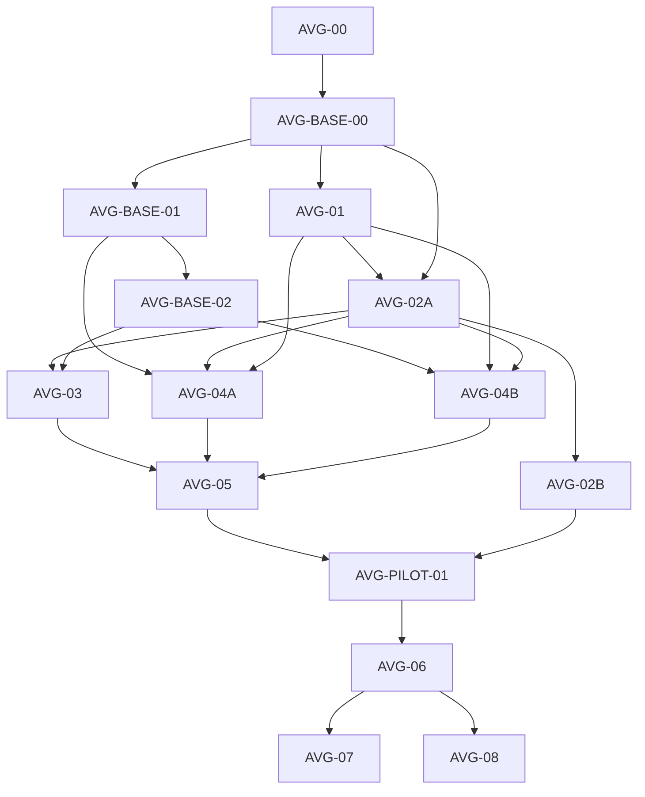

# AVG 实施计划与依赖顺序

> L2 · 版本：1.0.0 · 生效：2026-10-13 · 上位条目：E-AVG-01。
> 唯一产品施工入口：[AVG.md](../products/AVG.md)；逐包开工与验收：[工作包卡](AVG-WORK-PACKAGE-CARDS.md)。
> 本次交付 AVG-00 的正式设计。下列新代码单元均未实施，不以登记 backlog 宣称功能上线。

## 1 本次交付与下一单元

AVG-00 收口产品边界、三线/岗位/工件、运行/媒资/修订、质量及依赖，并登记 L2 权威与路由。本分支设计交付尚未代表主干合并；产品能力继续为 partial，L4 的完整商业场景/音频和真实生成缺口继续保留。

AVG 子路线的下一代码单元是 **AVG-BASE-00：版本化包、工件和消费接口基础**。先把新系统/媒体配置有地方合法存放、编译、发布和恢复，再接专业生成、物品系统及真实媒资。不能先扩旧 parser、在组件里加库存对象或直接发 TTS 请求。

当前授权止于设计与工作包；列出下一单元不启动代码实现或具体作品生产。正式实施按对应卡进入新产品增量，真实调用仍需要有效开始/路由/预算条件。

## 2 队列与最小交付

| ID | 状态 | 交付 | 前置/边界 |
|---|---|---|---|
| AVG-00 | 本轮设计交付 | 整体契约、四子规格、计划/开工卡、权威与上下文路由 | 文档检查；不是软件/作品 DONE |
| AVG-BASE-00 | NEXT | Settings/Package/Preview/Release Manifest V2、AVG 模块/工件/消费者 codec、版本/hash 和注册表接缝 | 复核最新基线；共享承载独立基础提交，AVG 语义不外溢 |
| AVG-BASE-01 | QUEUED | 实际参考输入与媒体能力/费用/异步 receipt 的版本化合同 | BASE-00；共享需求证明与其他受影响调用方回归 |
| AVG-BASE-02 | QUEUED | voice 参数/文本版本/真实 clip/对齐/权利与传输合同 | BASE-01 的媒资请求/receipt 基础；不是播放 UI 或已验证音色 |
| AVG-01 | QUEUED | S2 专用会谈和 S3 内容专业 Skill/工件、修订与真实校准入口 | BASE-00；先故事/人物/路线，再分场；不依赖物理库存已实现 |
| AVG-02A | QUEUED | 类型化规则、内容编译、声明式导演、基础舞台消费者 | BASE-00、AVG-01 的稳定主体/内容合同 |
| AVG-02B | QUEUED | 物品/证据、热点/地点、话题/消息、档案/辅助的可选模块 | 02A；首批先物品/证据和知识，其他模块逐项交付 |
| AVG-03 | QUEUED | 对话/voice 协调、分用途声音、历史/已读、存档/偏好/作品进度 | 02A、BASE-02；可以用授权导入音频检验播放，但不算自动 TTS |
| AVG-04A | QUEUED | 视觉岗位、真实参考/家族生产、加工/艺术采用与各视觉槽绑定 | BASE-01、AVG-01、02A；试点需求/槽稳定后生产 |
| AVG-04B | QUEUED | 声音/配音岗位、真实音频/审听/采用和逐句绑定 | BASE-02、AVG-01、02A；脚本与演法冻结 |
| AVG-05 | QUEUED | 三线制作台、实际联合预览、问题→局部返修及回执失效 | 01、02A、03、04A/B 的已交付范围；选用模块须对应 02B 就绪 |
| AVG-PILOT-01 | QUEUED | 原创 3～5 分钟完整戏与两种证据模式 | 05、02B 首批物件能力；生成模式还须真实参考/TTS 路由/预算 |
| AVG-06 | QUEUED | 15～30 分钟切片、真实对照/作者与独立玩家、修复版→旧档复测 | PILOT-01 blocking 清零；失败修同一切片，不增加规模掩盖 |
| AVG-07 | QUEUED | 独立交付/离线安装/鉴赏与版本 pin、指定渠道包和分发证据 | 06；受用到的档案/鉴赏模块及分发目标约束 |
| AVG-08 | LATER | 第二题材/配置通用性、长作品成本与高级表现 | 06 的生产闭环；高级表现另立能力与实测瓶颈 |

AVG-02、AVG-04 是 02A/02B 与 04A/04B 的聚合名称，不是额外重复工作包。子包有部分证据时标注范围，不将聚合单元宣布完成。AVG-02B 中 inventory/evidence 首批可先被 Pilot 使用，但不据此宣称消息/热点/辅助全部完成。

## 3 依赖图与并行条件

图表达交付前置，不要求独立创意任务顺序串行。01 内故事/人物、早期风格/声音方向可并行，系统骨架先于最终场景计划；02A 后导演与真实媒体部分可并行，配音必须等定稿句。05 可先开发 UI，但实际验收必须等待所用路径真实生效。

共享 schema/注册表/包/transport 调整由单一基础提交串行集成，再让产品包更新基线；不得将所有岗位与 renderer 一次塞入共享 executor。需要并行时使用各自独立 worktree，协调热点，不触碰共享主检出目录。

## 4 协议基础与兼容切换

| 基础 | 确定裁决 | 进入公共层的条件 |
|---|---|---|
| 新运行模块 | Settings V2、AVG Module V1、Presentation V2/Binding V1，Package/Preview/Release Manifest V2 显式承载，嵌套导入/运行来源 codec 同步分派 | Build Preview 与 ProductRelease 冻结/运行两类实际调用方都需同包校验；公共层只处理版本/生命周期，游戏语义由 AVG adapter/compiler 承担 |
| 新媒体请求 | V2 支持真实参考与 voice、能力快照/未知结果/费用；V1 文本请求仍合法 | 至少两个真实调用方需求；否则 AVG 扩展，不能“将来可能需要”直接抽象 |
| 新工件/来源 | 每个 AVG Skill/工件 schema 的唯一写域，按 purpose 的注册投影源 | 复用 FIELD/Adoption/Context/PROJECT_TABLES；不另建 AI/DB 入口 |
| 作品进度 | 拟增 AVG 专属进度表/作用域，运行状态继续用现有 session/events/checkpoint | 在 AVG-03 证明跨周目需求；登记完整导入导出/remap/delete/迁移 |

所有基础包必须先跑 V1 旧 AVG 与实际其他调用方正反例，再开放 V2。旧 release/preview/save 不改写；未来显式派生 V2 作品不继承未验证存档兼容。

新 AVG V2 专业路径就绪后，同一新作品的旧通用生成入口同步退出，不维持两个正式生成按钮或 owner。V1 只读/旧档回归仍存在；若 V2 未达到正式门，入口按实验性默认隐藏。回滚功能入口不删除已存在数据或把 V2 写进 V1 parser。

## 5 验证与工作量

本次只做文档权威、链接/表格、ID/依赖/所有权和 Git 差异检查，不运行产品 CI/E2E 或真实付费调用。未来代码单元遵守 AGENTS 的定向测试、架构/表/AI Manual、TypeScript、build/ci 门；涉及 UI/API、数据恢复/跨线时在隔离浏览器项目跑 E2E，保护作者当前数据库。

模型/媒资真实任务、作者实际采用、独立玩家与指定分发环境分别建立验收回执。fixture、《雾港》旧素材和导入模式可用于工程回归；不能充当专业生成、参考传输、配音艺术或商业验证。

不预报未经试验的工期/总价。每包开工时估算范围，区分软件研发时间与具体作品的生成/废弃/处理/返修/审听/试玩工时和现金；Pilot 后用实测数据更新 06/08 规模和可行性。若专业拆分质量/采用或总投入没有收益，调整方法/粒度再测，不因岗位数多继续扩建。

## 6 交接与集成

每包有独立分支、明确 commit/PR/最终 head 和证据，按 [协作流程](../COLLAB-WORKFLOW.md)交接；当前设计登记不授权 main 合并/部署。后续每包从最新治理基线施工，变更前复核入口→读取→候选/采用→生命周期→消费者→测试闭包。

高风险未解问题停在对应包，保留可重现证据。方案不能替代实际账号能力、收费授权、真实图片/音频、作者操作或玩家参与；这些条件尚未满足时维持对应 unknown/未完成状态。
